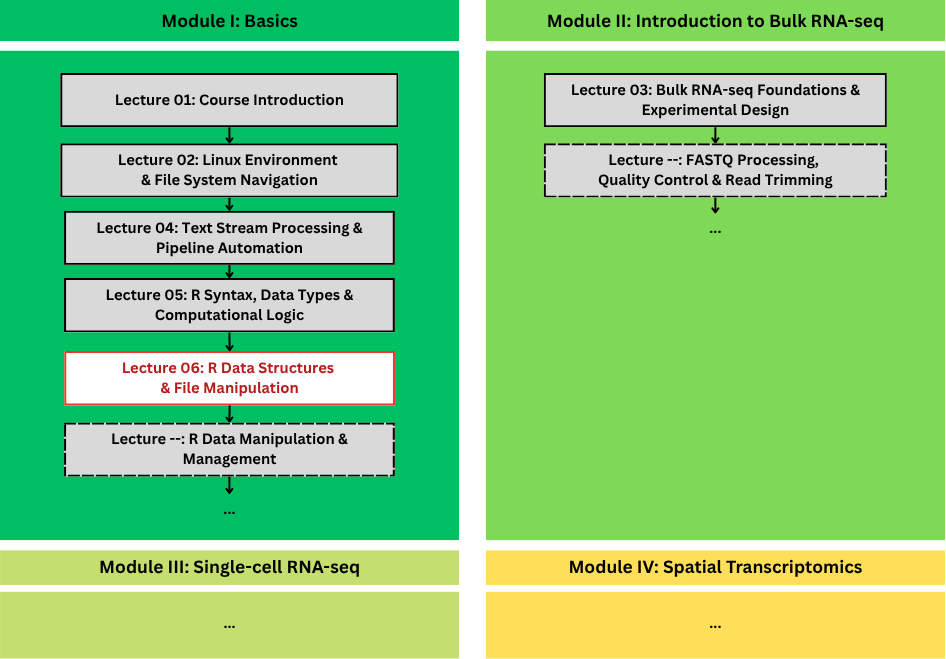
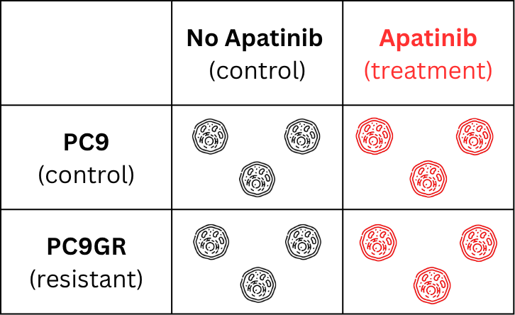
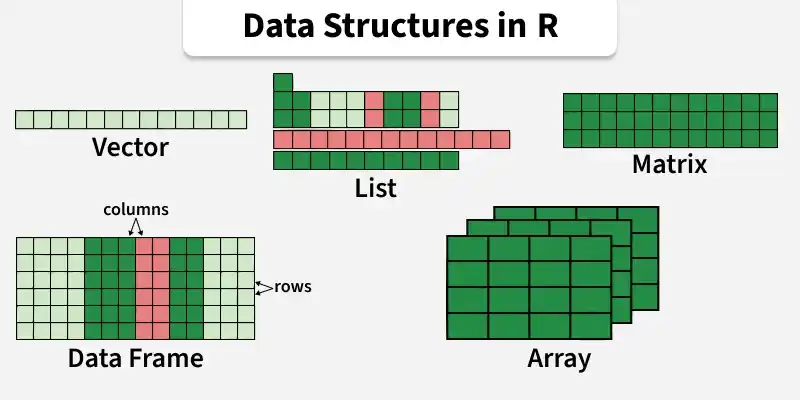
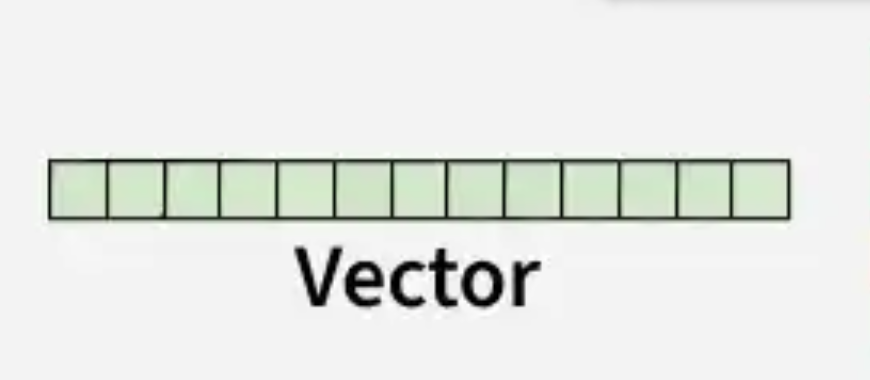
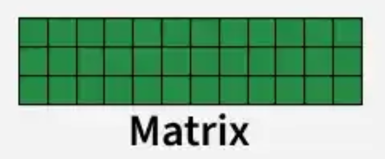
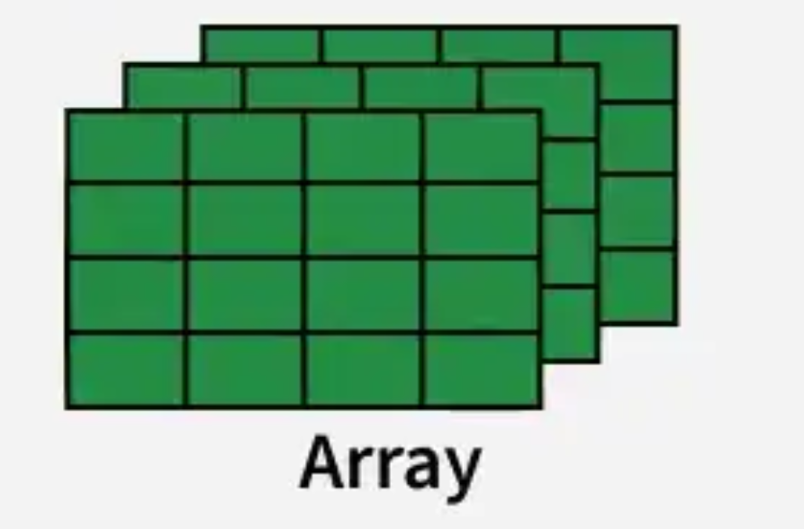
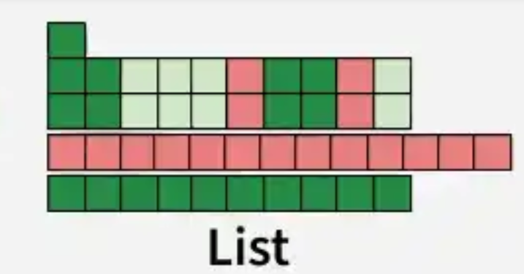
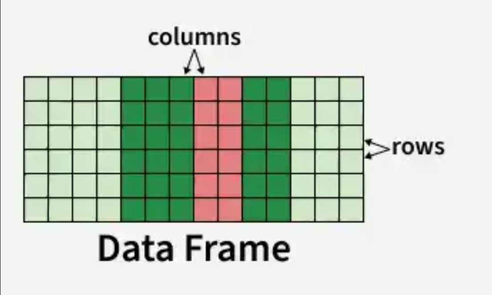

## 🔁 Review: Lecture 5

Before new structures, ten minutes on last week's ground: syntax, variables, types, math, strings, operators, control flow.

::: {.callout-important}
### ⏱️ No Notes, No Peeking
Three rapid-fire rounds, then one warm-up in live R. Write your answers first — reading the solution twice teaches you nothing.
:::

---

::: {.section-tag}
🔁 Review: Lecture 5
:::

### ⚡ Rapid Fire 1 — Syntax & Variables

::: {.slide-kicker}
No peeking!
:::

1. You type `print("hello)` and press `Enter`. What happens?
2. How do you store the value `150` in a variable called `x`?
3. Two of these names **crash R**. One is legal but dangerous. One is perfectly safe. Which is which?
  - `1gene`
  - `cell count`
  - `gene_A`
  - `Gene_A`

---

::: {.section-tag}
🔁 Review: Lecture 5
:::

### ✅ Rapid Fire 1 — Syntax & Variables

1. Nothing crashes and **nothing runs**. The console sits on a **`+`** prompt, waiting for the rest of the string — it stays stuck until every quote and bracket matches
2. **`x <- 150`**
3. `1gene` and `cell count` → **syntax errors, R stops**. `Gene_A` → **legal but dangerous**: a different variable from `gene_A`. `gene_A` → **safe**

---

::: {.section-tag}
🔁 Review: Lecture 5
:::

### ⚡ Rapid Fire 2 — Types, Math & Strings

::: {.slide-kicker}
No peeking!
:::

1. What type is `150`? What type is `"EGFR"`?
2. `10 %% 3` versus `10 %/% 3`?
3. `read.csv("data\visium\counts.csv")` crashes. Why, and what is the rule?

---

::: {.section-tag}
🔁 Review: Lecture 5
:::

### ✅ Rapid Fire 2 — Types, Math & Strings

1. `150` is **`numeric`**. `"EGFR"` is **`character`** — the quotes make it text, so it can never be counted or averaged
2. `1` and `3`: **`%%`** returns the remainder, **`%/%`** floor-divides
3. `\` is the **escape character**, so `\v` and `\c` are invalid codes. The rule: **always use forward slashes `/`** in R paths

---

::: {.section-tag}
🔁 Review: Lecture 5
:::

### ⚡ Rapid Fire 3 — Operators & Control Flow

::: {.slide-kicker}
No peeking!
:::

1. Your `if` tested one condition and it came back `FALSE`. How do you check a **second** condition?
2. Write the R test for `500 <= x <= 2500`.
3. In a `for` loop, how do `next` and `break` differ?

---

::: {.section-tag}
🔁 Review: Lecture 5
:::

### ✅ Rapid Fire 3 — Operators & Control Flow

1. Add an **`else if`** — it runs only when the condition above it was `FALSE`, and the **first** `TRUE` branch wins
2. Two comparisons joined: **`(x >= 500) & (x <= 2500)`**. R has no chained comparisons
3. `next` **skips** the rest of the current iteration and keeps going; `break` **aborts the loop entirely**

---

::: {.section-tag}
🔁 Review: Lecture 5
:::

### 🎯 Lecture 5, Closed

* **The Basics** — comments, `<-`, naming
* **Values** — types, `NA` / `NaN` / `Inf`
* **Numbers** — `%%`, `%/%`, log2, CPM
* **Text** — quotes, `cat()`, escapes
* **Logic** — `==`, `&`, `|`, `!`, no chaining
* **Flow** — `if` / `else`, `for`, `next`, `break`, `while`

Everything from here builds **on top** of this.

---

## 🗺️ Where We Are in the Course

{fig-align="center" width="88%"}

---

## 📂 Case Study: [GSE129221](https://www.ncbi.nlm.nih.gov/geo/query/acc.cgi?acc=GSE129221)

::::: {.columns}

::: {.column width="48%"}
{fig-align="center" width="100%"}

::: {style="font-size: 0.42em; text-align: center; color: #999; line-height: 1.35;"}
Song, Y.-A., Ma, T., Zhang, X.-Y., Cheng, X.-S., Olajuyin, A.-M., Sun, Z.-F., & Zhang, X.-J. (2019). Apatinib preferentially inhibits PC9 gefitinib-resistant cancer cells by inducing cell cycle arrest and inhibiting VEGFR signaling pathway. *Cancer Cell International, 19*(1), 117. [https://doi.org/10.1186/s12935-019-0836-8](https://doi.org/10.1186/s12935-019-0836-8)
:::
:::

::: {.column width="52%"}

- **Gefitinib** works on **EGFR-mutant lung cancer** — until **resistance appears**. 
- **Apatinib kills cancer cells by freezing them in G1** — cell-cycle genes go quiet instead of the cells dying.

:::

:::::

---

## 📂 The Design

::::: {.columns}

::: {.column width="52%"}
{fig-align="center" width="100%"}
:::

::: {.column width="48%"}

2 cell lines $\times$ 4 groups $\times$ 3 replicates each = 12 samples.

::: {.slide-kicker}
Your Turn!
:::

**Which comparison answers the paper's question, and which is the easy control?**
:::

:::::

---

## 📂 The Question

Which genes change when apatinib hits **resistant** cells — and do the *same* genes change in the **sensitive** ones?


- **To analyze, we need:** a **count matrix** (39,376 genes × 12 samples)

::: {.callout-tip}
### 🎯 Today Is Plumbing
The whole lecture is about getting this one object into R **correctly** — structures, strings, `NA`, `apply`, functions, merging. 
:::

---

## 📂 Before We Download

Let's make a folder for the data.

```bash
mkdir -p counts      # create it once
cd counts
```

---

## 📂 curl: Fetch the Counts Matrix

```bash
curl -o counts.tsv.gz \
  "https://www.ncbi.nlm.nih.gov/geo/download/?type=rnaseq_counts&acc=GSE129221&format=file&file=GSE129221_raw_counts_GRCh38.p13_NCBI.tsv.gz"

gunzip counts.tsv.gz     # .tsv.gz -> .tsv
```


::: {.callout-tip}
### 💡 Always `-o`, Always Quote
GEO's `content-disposition` header makes `-O` unreliable here, so name the file yourself.
:::

---

## 📂 Why a Script?

That was two lines — and one was a **136-character URL**.

::: {.columns}
::: {.column width="50%"}
**By hand**

* a mistyped character
* a different file tomorrow
* thirty files next week
:::
::: {.column width="50%"}
**By script**

* `./download.sh`
* edit one line
* same result, every time
:::
:::

::: {.callout-tip}
### ♻️ Six Months From Now
A script is a text file anyone can read. A shell history is not.
:::

---

## 📂 download.sh

```bash
#!/usr/bin/env bash
set -euo pipefail

OUT_DIR="./counts"
mkdir -p "$OUT_DIR"

curl -o "$OUT_DIR/counts.tsv.gz" \
  "https://www.ncbi.nlm.nih.gov/geo/download/?type=rnaseq_counts&acc=GSE129221&format=file&file=GSE129221_raw_counts_GRCh38.p13_NCBI.tsv.gz"

gunzip -f "$OUT_DIR/counts.tsv.gz"

echo "File downloaded at $OUT_DIR/counts.tsv:"
ls -lh "$OUT_DIR"

echo "Head of the file:"
head -n 5 "$OUT_DIR/counts.tsv"
```

::: {.callout-note}
### 🧊 `set -euo pipefail` in One Line
Stop on the first error · fail on unset variables · fail on any failed pipe. Without it, a broken download scrolls past and you analyse an HTML error page as counts.
:::

---

## 📂 Making the script executable


```bash
chmod +x download.sh    # RUN ONLY ONCE!
./download.sh           # Script is executable now!
```

---

## 📂 counts/README.md

```markdown
# counts/

Raw RNA-seq data for **[GSE129221](https://www.ncbi.nlm.nih.gov/geo/query/acc.cgi?acc=GSE129221)** (Song et al. 2019, Cancer Cell Int 19:117).

| File | Source | Notes |
|---|---|---|
| `counts.tsv` | GEO (via download.sh) | 39,376 genes x 12 samples, raw counts |

Run `./download.sh` to fetch it
```

::: {.callout-tip}
### 📝 Data Provenance
A README beside your data answers *what is this, where did it come from, and is it complete* without opening a browser tab.
:::

---

## 🧬 So... What Now?

You have the count matrix. It is not yet *useful* information:

* Rows are **Entrez IDs** — `100287102` tells you nothing
* Columns are **GSM accessions** — PC9 and PC9GR look identical
* **Many** genes are zero in every sample

---

## 📋 1. R Data Structures

::: {.agenda data-section="1"}
:::

---

### The Family Tree

{fig-align="center" width="78%"}

::: {style="font-size: 0.5em; text-align: center; color: #999;"}
Source: [geeksforgeeks.org](https://www.geeksforgeeks.org/r-language/data-structures-in-r-programming/)
:::

::: {.callout-note}
### 🎯 What You Will Actually Use
Vectors and data frames every single day. Matrices for count matrices and images. Lists hide behind `read.csv()`, model fits and packages. Factors for every categorical annotation.
:::

---

### Vectors — Same Type, One Dimension

A **vector** is a 1D chain of values that all share the same type.

:::: {.columns}

::: {.column width="45%"}
{fig-align="center" width="85%"}
:::

::: {.column width="55%"}
```{webr-r}
vals <- c(10, 20, 30)
vals
```
:::

::::


---

### Vectors — Same Type, One Dimension


A plain sequence:

```{webr-r}
1:5
```

and a custom one
```{webr-r}
seq(2, 10, by = 2)
```

Or, repetition:

```{webr-r}
rep(1, 10) # repeat 1 ten times
```

::: {.callout-note}
Once a vector exists, every function in R expects one. `mean()`, `sum()`, `length()` all take vectors.
:::


---

### Subsetting Vectors

**Counting Starts at 1**

```{webr-r}
#| autorun: true
gene_reads <- c(1200, 450, 0, 89, 3300)
gene_reads
```

```{webr-r}
gene_reads[2]     # one value (the 2nd element)
```

```{webr-r}
gene_reads[2:4]   # a range
```

```{webr-r}
gene_reads[-2]    # negative index REMOVES element 2
```

::: {.callout-important}
### 🧬 Bio Example
`gene_reads[gene_reads > 500]` keeps only the highly expressed genes — the R version of filtering a column in Excel. Index `0` does not exist, so the first element is `[1]`, never `[0]`.
:::


---

### Matrices — Same Type, Two Dimensions

A **matrix** is a 2D grid where every cell holds the same type. Spot metadata matrices are exactly this shape.

:::: {.columns}

::: {.column width="45%"}
{fig-align="center" width="85%"}

::: {.callout-warning}
### ⚠️ Fills by Column
Values fill down columns by default. Add `byrow = TRUE` to fill row-by-row.
:::
:::

::: {.column width="55%"}
```{webr-r}
#| autorun: true
# 3 genes (rows) x 2 cohorts (cols)
count_mat <- matrix(c(120, 45, 0, 310, 85, 12), nrow = 3, ncol = 2)
count_mat
```

```{webr-r}
dim(count_mat)      # [rows, cols]
```

```{webr-r}
count_mat[1, 2]     # Row 1 (Gene 1), Col 2 (Cohort 2)
```
:::

::::


---

### Naming Rows and Columns

```{webr-r}
#| autorun: true
count_mat <- matrix(c(120, 45, 0, 310, 85, 12), nrow = 3, ncol = 2)

# Name the 3 genes (rows) and 2 cohorts (columns)
rownames(count_mat) <- c("EPCAM", "CD3D", "PECAM1")
colnames(count_mat) <- c("Tumor", "Normal")
count_mat
```

```{webr-r}
count_mat[, "Tumor"]     # Entire 'Tumor' column across all genes
```

```{webr-r}
count_mat["EPCAM", ]     # Entire 'EPCAM' row across all cohorts
```

::: {.callout-tip}
Labelled matrices print like a real annotation table — always name them before you show anyone your numbers.
:::


---

### Arrays — Matrices Stacked

:::: {.columns}

::: {.column width="45%"}
{fig-align="center" width="85%"}

::: {.callout-note}
### 🖼️ Bio Example
Arrays are 3D+ data. Histology H&E images (height × width × RGB channels) are stored this way.
:::
:::

::: {.column width="55%"}
```{webr-r}
#| autorun: true
# 2 rows x 3 cols x 2 slices (e.g. RGB / intensity channels)
layers <- array(c(255, 128, 45, 0, 89, 210, 180, 95, 15, 0, 72, 190), 
                dim = c(2, 3, 2))
layers
```

```{webr-r}
dim(layers)       # [rows, cols, slices]
```

```{webr-r}
layers[1, 2, 1]   # Row 1, Col 2, Slice 1
```
:::

::::


---

### Lists — A Box of Anything

Elements can have completely different types and lengths

:::: {.columns}

::: {.column width="45%"}
{fig-align="center" width="85%"}

::: {.callout-important}
### 💡 `[[ ]]` vs `[ ]`
`[[ ]]` extracts the **actual value**. `[ ]` extracts a **sublist** holding the value. Always use `[[ ]]` (or `$`) to compute with the data.
:::
:::

::: {.column width="55%"}
```{webr-r}
#| autorun: true
spot <- list(name = "Visium_S1", 
             counts = c(120, 45, 0), 
             qc_pass = TRUE)
spot
```

```{webr-r}
spot[["qc_pass"]]   # Extracts value
```

```{webr-r}
spot["qc_pass"]     # Extracts a sublist
```
:::

::::


---

### Data Frames — The Workhorse

A **data frame** is a 2D table where each column keeps its own type. This is your spot-metadata table.

:::: {.columns}

::: {.column width="45%"}
{fig-align="center" width="85%"}

::: {.callout-note}
### 💡 Columns are Vectors
Each column is a **vector** wearing a name. That is why you can do `spots$umi_count > 10` and get a logical vector back.
:::
:::

::: {.column width="55%"}
```{webr-r}
#| autorun: true
spots <- data.frame(
  spot_id   = c("S1", "S2", "S3"),
  umi_count = c(12, 45, 0),
  in_tissue = c(TRUE, TRUE, FALSE)
)

spots
```
:::

::::


---

### Getting Oriented in a Data Frame

```{webr-r}
#| autorun: true
spots <- data.frame(
  spot_id   = c("S1", "S2", "S3"),
  umi_count = c(12, 45, 0),
  in_tissue = c(TRUE, TRUE, FALSE)
)
head(spots, n = 2)   # First rows
```

```{webr-r}
dim(spots)           # [rows, columns]
```

```{webr-r}
str(spots)           # Structure: types + preview of values
```

::: {.callout-tip}
### 🧭 The Five-Line Tour
Run `head()`, `dim()`, `str()` on **every** dataset you meet. Ninety seconds here saves an hour of confused errors later.
:::


---

### Subsetting Data Frames

```{webr-r}
#| autorun: true
spots <- data.frame(
  spot_id   = c("S1", "S2", "S3"),
  umi_count = c(12, 45, 0),
  in_tissue = c(TRUE, TRUE, FALSE)
)
spots$umi_count                                     # 1. Extract one column as a vector
```

```{webr-r}
spots[spots$umi_count > 10, ]                      # 2. Filter rows by condition
```

```{webr-r}
spots[spots$in_tissue, c("spot_id", "umi_count")]  # 3. Filter rows AND select columns
```

::: {.callout-important}
### 📐 The Comma Means "and"
`df[rows, columns]` — think of it as `df[what rows I want, what columns I want]`. Leave the row part empty (`df[, 1]`) for "all rows"; leave the column part empty (`df[1, ]`) for "all columns".
:::

---

::: {.section-tag}
1. R Data Structures · Extra
:::

### Factors — Categories, With an Order

A **factor** stores category labels plus the list of allowed levels — the R way to hold annotation columns.

```{webr-r}
#| autorun: true
cell_types <- factor(c("T-cell", "B-cell", "T-cell", "T-cell"))
levels(cell_types)
```

```{webr-r}
table(cell_types)
```

::: {.callout-note}
### 💡 Levels Order
Levels are **alphabetical by default**. Specify order with `factor(x, levels = c(...))` before plotting or modelling.
:::

---

::: {.section-tag}
1. R Data Structures · Extra
:::

### Tibbles — Modern Data Frames

A **tibble** (`tbl_df`) is an enhanced modern data frame from the *tidyverse*.

* **Better printing**: Previews only the first 10 rows and columns that fit your screen.
* **Safer subsetting**: Never silently drops down to a vector when you select one column with `[ , 1]`.
* **Strict typing**: Never converts strings to factors automatically.

::: {.callout-tip}
### 📦 Tibble vs Data Frame
Base R functions always accept data frames; `tibble` objects are 100% compatible and inherit from `data.frame`.
:::

---

::: {.section-tag}
1. R Data Structures · Extra
:::

### Creating a Tibble

```{webr-r}
library(tibble)

# Tibbles print dimensions and column types (<chr>, <dbl>) clearly:
my_spots <- tibble(
  spot_id   = c("S1", "S2", "S3"),
  umi_count = c(12, 45, 0),
  in_tissue = c(TRUE, TRUE, FALSE)
)

my_spots
```

---

::: {.section-tag}
1. R Data Structures · Exercise
:::

### ✍️ Exercise 6.1: What Kind of Object Should This Table Be?

Four genes, three samples:

| gene_id | S1 | S2 | S3 |
|:---|---:|---:|---:|
| gene_A | 2 | 3 | 1 |
| gene_B | 0 | 45 | 12 |
| gene_C | 310 | 85 | 0 |
| gene_D | 89 | 12 | 640 |

Two data types live here: gene IDs (**text**) and read counts (**numbers**).

* a) Vector
* b) Matrix
* c) Array
* d) List
* e) Data frame

---

::: {.section-tag}
1. R Data Structures · Exercise
:::

### ✅ Exercise 6.1: What Kind of Object Should This Table Be?

**e) Data frame** — the only structure that is both rectangular *and* lets each column keep its own type.

```r
counts <- data.frame(
  gene_id = c("gene_A", "gene_B", "gene_C", "gene_D"),
  S1 = c(2, 0, 310, 89),
  S2 = c(3, 45, 85, 12),
  S3 = c(1, 12, 0, 640),
  row.names = 1
)
```

| Structure | Why it fails |
|:---|:---|
| a) Vector | One long line. No rows, no columns, no way to ask for "S1". |
| b) Matrix | One type for everything. The `gene_id` column is text. |
| c) Array | Same one-type rule, plus a third dimension this table does not have. |
| d) List | Holds anything, but has no row/column order — `tbl[, 1]` means nothing. |

---

::: {.section-tag}
1. R Data Structures · Exercise
:::

### ✍️ Exercise 6.2: What Shape Is `counts`?

```r
counts <- data.frame(
  gene_id = c("gene_A", "gene_B", "gene_C", "gene_D"),
  S1 = c(2, 0, 310, 89),
  S2 = c(3, 45, 85, 12),
  S3 = c(1, 12, 0, 640),
  row.names = 1
)
```

What does `dim(counts)` give you?

* a) `3 4`
* b) `4 3`
* c) `1 3`
* d) `4 4`

---

::: {.section-tag}
1. R Data Structures · Exercise
:::

### ✅ Exercise 6.2: What Shape Is `counts`?

**b) `4 3`**

`dim()` is always **rows, then columns**.

* **Rows = genes**, running down the page
* **Columns = samples**, running across the top

```r
dim(counts)              # 4 3
head(rownames(counts))   # "gene_A" "gene_B" "gene_C" ...
```

::: {.callout-note}
### 🧬 Rows Are the Genes
The gene IDs became **row labels**, not a column — that is what `row.names = 1` did. Without it you would have 4 columns and `4 4`.
:::

---

::: {.section-tag}
1. R Data Structures · Exercise
:::

### ✍️ Exercise 6.3: Pull One Sample

You want the read counts for `S1` only, as a **vector**.

* a) `counts[1, ]`
* b) `counts$S1`
* c) `counts[S1]`
* d) `counts["S1"]`

---

::: {.section-tag}
1. R Data Structures · Exercise
:::

### ✅ Exercise 6.3: Pull One Sample

**b) `counts$S1`** — `$` pulls the column out by name and hands you the bare values.

```r
counts$S1        # 2 0 310 89 — all 4 genes, that one sample
```

| Option | Why not |
|:---|:---|
| a) `counts[1, ]` | one **gene** (`gene_A`), all 3 samples — the wrong way round |
| c) `counts[S1]` | `Error: object 'S1' not found` |
| d) `counts["S1"]` | a **4×1 data frame** — one column, wrapped in a table, not a vector |

::: {.callout-tip}
### 🧬 Want the Vector? Use `[[ ]]`
`counts[[1]]` and `counts[["S1"]]` both unwrap to the same thing: `2 0 310 89`.
:::

---

## 📋 2. Reading, Writing & Merging Files

::: {.agenda data-section="2"}
:::
---

### Where Am I?

```r
getwd()                      # print the current working directory
dir()                        # list what is inside it
setwd("~/projects/spatial")  # move to a project folder
```

::: {.callout-important}
### 🧬 Never Hard-Code Absolute Paths
`/Users/phongdinh/...` works on your laptop and on nobody else's — every hard-coded path is a reproducibility bug waiting for a co-author or reviewer.
:::

---

### Paths Are Relative to Where You Stand

One path, two folders. Walk into a subdirectory and the **same** line flips its answer:

```r
f <- "FCWT_2026/lecture-06/counts/counts.tsv"
```

From the repo root:

```r
getwd()          # Spatial_Transcriptomics_Course
file.exists(f)   # TRUE
```

Now step one level deeper — nothing about `f` changes:

```r
setwd("FCWT_2026/lecture-06")
getwd()          # Spatial_Transcriptomics_Course/FCWT_2026/lecture-06
file.exists(f)   # FALSE
```

::: {.callout-important}
### 🧬 The File Did Not Move
`counts/counts.tsv` is right where it was. Only `getwd()` changed — and that is enough to make R look somewhere else entirely.
:::

---

### The Fix: Anchor to the Project Root

`here()` builds the path from the project root, so the answer stops depending on where you stand:

```r
library(here)
f <- here("FCWT_2026", "lecture-06", "counts", "counts.tsv")

file.exists(f)   # TRUE — from the repo root
file.exists(f)   # TRUE — from analysis/code/ too
```

::: {.callout-tip}
### 📦 Install with `install.packages("here")`
Inside a script, `here::i_am("analysis/code/demo.R")` pins the root explicitly.
:::

---

### Read: the Real Count Matrix

The file you downloaded in the first half of this lecture. It is tab-separated, so `read.delim()` is the right call:

```r
library(here)
f <- here("FCWT_2026", "lecture-06", "counts", "counts.tsv")

counts <- read.delim(f, row.names = 1)

dim(counts)     # 39376 12
head(counts)    # first 6 genes, all 12 samples
```

::: {.callout-tip}
### 🔑 Why `row.names = 1` on the Way In
The first column holds Entrez gene IDs. With `row.names = 1` that column becomes the labels you address genes by. Without it you get **13** columns, and the IDs sit there as ordinary data.
:::

---

::: {.section-tag}
2. Reading, Writing & Merging Files · Extra
:::

### Base R Table Readers Compared

All `read.*` functions wrap `read.table()`, but differ in default parameters:

::: {.small}
| Function | `sep` | `header` | `dec` | Use Case |
|:---|:---:|:---:|:---:|:---|
| **`read.delim()`** | `\t` (Tab) | `TRUE` | `.` | **TSV count matrices & annotations** |
| `read.csv()` | `,` (Comma) | `TRUE` | `.` | Standard CSV files (US/UK) |
| `read.table()` | `""` (Space) | `FALSE` | `.` | Space-separated raw tables |
| `read.delim2()` / `csv2()` | `\t` / `;` | `TRUE` | `,` | European decimal comma format |
:::

::: {.callout-note}
### ⚡ Large Datasets (>100 MB)
Base R functions load into memory as standard data frames. For huge single-cell matrices, `data.table::fread()` or `readr::read_tsv()` are significantly faster.
:::

---

### Write: Save a Slice to Disk

Export a subset to disk with `write.csv()`:

```r
small <- head(counts, 5)

# Export with row labels (gene IDs) preserved:
write.csv(small, "counts_head.csv", row.names = TRUE)
```

::: {.callout-warning}
### ⚠️ Keep `row.names = TRUE` (Default)
If set to `FALSE`, row names (gene IDs) are dropped, leaving numbers without gene identifiers!
:::

---

### The Problem: Opaque Sample IDs

Look at the column headers of your count matrix:

```r
colnames(counts)
# [1] "GSM3702795" "GSM3702796" "GSM3702797" "GSM3702798" ...
```

- GEO accessions (`GSM...`) tell you **nothing** about the biology.
- Which samples are untreated controls? Which received Apatinib? Which are drug-resistant?
- We need **sample metadata** mapped to these accession IDs.

---

### Create & Save a Sample Metadata Table

Build the lookup mapping and save it to disk with `write.csv()`:

```r
sample_info <- data.frame(
  sample_id = colnames(counts),
  cell_line = rep(c("PC9", "PC9GR"), each = 6),
  treatment = rep(c("Control", "Apatinib", "Control", "Apatinib"), each = 3)
)

# Save sample metadata table for your project:
write.csv(sample_info, "sample_metadata.csv", row.names = FALSE)
head(sample_info, 4)
```

---

### Merge Metadata with Expression Summaries

Calculate total reads per sample, then link them with `merge()`:

```r
# Total sequenced reads per sample:
lib_sizes <- data.frame(
  sample_id   = colnames(counts),
  total_reads = colSums(counts)
)

# Merge metadata with library sizes by matching sample_id:
sample_summary <- merge(sample_info, lib_sizes, by = "sample_id")
head(sample_summary, 4)
```

::: {.callout-tip}
### 🔑 `merge(x, y, by = "key")`
Base R's `merge()` aligns rows automatically using a shared ID key — no manual index matching needed!
:::

---

### Large Files: Skip read.csv()

```r
# Base R is correct but slow on big matrices
slow <- read.csv("visium_counts.csv")

# data.table::fread() is 10-100x faster on the same file
library(data.table)
fast <- fread("visium_counts.csv")

# Spot coordinates
coords <- fread("tissue_positions_list.csv")
```

::: {.callout-note}
### ⚡ Rule of Thumb
Under ~100 MB: `read.csv()` is fine. Above that: `data.table::fread()`. You will meet the threshold the day you load your first gene-by-spot matrix.
:::

---

## 📋 3. Vectorization & the apply Family

::: {.agenda data-section="3"}
:::
---

### The Problem

How many genes read **zero** in every sample?

```{r}
counts <- read.delim("counts/counts.tsv", row.names = 1)

silent_gene <- 0
for (i in 1:nrow(counts)) {
  s <- sum(counts[i, ])
  if (s == 0) {
    silent_gene <- silent_gene + 1
  }
}
silent_gene   # 10261
```

---

### The Solution: One Operation, Whole Table

The same 39,376 numbers, in one call:

```{r}
gene_means_fast <- rowMeans(mat)

# Identical values — the loop's vector had no names, this one does
identical(unname(gene_means_loop), unname(gene_means_fast))   # TRUE

head(gene_means_fast, 3)
head(names(gene_means_fast), 3)   # "100287102" "653635" "102466751" — free gene labels
```

Don't take my word for the speedup — run it. This uses the **same shape** as the real matrix (39,376 genes × 12 samples):

```{webr-r}
#| autorun: false
# Be patient: this loop is the slow one, and the browser is slower than RStudio.
big <- matrix(rep(1:12, 39376), nrow = 39376)

t_loop <- system.time(for (i in seq_len(nrow(big))) mean(big[i, ]))
t_vec  <- system.time(rowMeans(big))

c(loop = t_loop[["elapsed"]], rowMeans = t_vec[["elapsed"]])
```

Your absolute numbers will be larger than mine — this is R compiled to WebAssembly, not native R. **The ratio is the point**: one trip, versus 39,376.

The rest of the family was already there:

```{r}
rowSums(mat)     # total reads per gene
colMeans(mat)    # mean expression per sample
range(mat)       # smallest and largest count in the whole table
```

::: {.callout-tip}
### 🎯 The Rule
If a function already comes in families — `mean()`, `sum()`, `rowMeans()`, `colSums()` — reach for those first. `apply()` is for when **no** built-in exists.
:::

---

### apply(): The Margin Decides Everything

```{webr-r}
count_matrix <- matrix(1:12, nrow = 3, ncol = 4)

# MARGIN 1 = one value per ROW
apply(count_matrix, 1, mean)

# MARGIN 2 = one value per COLUMN
apply(count_matrix, 2, mean)
```

::: {.callout-important}
### 📐 Margin = The Axis You Collapse
* `MARGIN = 1` → R goes **down** the columns, returning one value per **row**
* `MARGIN = 2` → R goes **across** the rows, returning one value per **column**

Say "down" for 1, "across" for 2, and you will never mix them up again.
:::

---

### 🎭 `apply()` Is a Loop Wearing a Mask

`apply(X, 1, mean)` slices out each row, calls `mean()` **once per row**, and pastes the answers back together. It is the `for` loop from two slides ago — with better manners.

```{webr-r}
#| autorun: true
count_matrix <- matrix(1:12, nrow = 3, ncol = 4)

# Same numbers, two very different journeys
rowMeans(count_matrix)
apply(count_matrix, 1, mean)
```

At three rows you cannot see the cost. Scale up:

```{webr-r}
#| autorun: false
big <- matrix(rep(1:12, 20000), nrow = 20000)   # 20,000 genes

c(apply    = system.time(apply(big, 1, mean))[["elapsed"]],
  rowMeans = system.time(rowMeans(big))[["elapsed"]])
```

::: {.callout-important}
### 🕵️ When `apply()` Earns Its Place
Identical answers, wildly different cost. `rowMeans()` hands the whole grid to compiled C in **one** call; `apply()` walks it in **20,000**.

So `apply()` is the tool for when **no dedicated function exists** — your own function, an unusual margin-dependent statistic. The moment a `row*()` / `col*()` twin exists, take it.
:::

---

### lapply() vs sapply()

```{webr-r}
umi <- c(4, 9, 16, 25)

# lapply: ALWAYS returns a list
lapply(umi, sqrt)

# sapply: same work, simplified to a vector when possible
sapply(umi, sqrt)
```

::: {.callout-note}
`lapply()` never surprises you — the shape of the answer always matches the input shape. `sapply()` tries to be prettier and occasionally returns a matrix instead of a vector. When the shape matters, use `lapply()`.
:::

---

### tapply(): Summarise by Group

```{webr-r}
expression <- c(12, 15, 100, 110, 8)
groups <- factor(c("Control", "Control", "Treated", "Treated", "Control"))

# Mean expression per group, in one line
tapply(expression, groups, mean)
tapply(expression, groups, sum)
```

::: {.callout-tip}
This single pattern replaces most of your pivot tables: **group a numeric vector by a factor, summarise it**. Differential expression at its core is `tapply` with a test function instead of `mean`.
:::

---

### Choosing the Right Tool

| Function | You give it | You get back |
|:---|:---|:---|
| `apply` | matrix / data frame + margin | vector or matrix |
| `lapply` | list / vector | list (always) |
| `sapply` | list / vector | simplified vector (usually) |
| `tapply` | vector + grouping factor | vector per group |
| `colMeans` | matrix | one number per column |

::: {.callout-tip}
Work top to bottom: check the dedicated function, then `apply`, then `lapply`/`sapply`, then `tapply`.
:::

---

## 📋 4. Strings & Regular Expressions

::: {.agenda data-section="4"}
:::
---

### The Problem: Messy Gene Labels

Your gene list looks like this:

```{webr-r}
genes <- c("GAPDH", "ACTB-mouse", "CD8A-mouse", "IL6")
genes
```

You need the suffix stripped and the cases normalised — across 20,000 rows.

::: {.callout-important}
### 🛑 Why Not Find-and-Replace in Excel?
Because the labels are not identical: `"ACTB-mouse"`, `"Actb-mouse"` and `"ACTB"` are three different strings. A **pattern** catches all of them; a literal search does not.
:::

---

### grep(): Find the Matches

```{webr-r}
genes <- c("GAPDH", "ACTB-mouse", "CD8A-mouse", "IL6")

grep("mouse", genes)                  # which positions?
grep("mouse", genes, value = TRUE)    # which values?
grep("mouse", genes, invert = TRUE)   # which do NOT match?
```

::: {.callout-tip}
`grep()` gives you **indices**, so it plugs straight into subsetting: `genes[grep("mouse", genes)]`. Give it `value = TRUE` when you just want to eyeball the hits.
:::

---

### sub() vs gsub(): Replace Text

```{webr-r}
genes <- c("GAPDH", "ACTB-mouse", "CD8A-mouse", "IL6")

sub("-mouse", "", genes)    # replaces the FIRST match
gsub("-mouse", "", genes)   # replaces EVERY match
```

::: {.callout-note}
`sub()` is the surgical tool, `gsub()` is the hammer. `gsub("-", "", x)` will strip **every** hyphen in a string — which is exactly why you should test on `genes` first, not on a production column.
:::

---

### Case, Length & Slicing

```{webr-r}
genes <- c("gapdh", "ACTB-mouse", "Cd8a-MOUSE", "il6 ")

toupper("gapdh")            # force case
nchar(genes)                # how many characters?
trimws("  Tumor  ")         # trim stray whitespace
```

::: {.callout-tip}
Whitespace is invisible and deadly. A label with one trailing space will never match a database key. Run `trimws()` on every text column you import.
:::

---

### Pattern Cheat Sheet

| Pattern | Matches | In gene labels |
|:---|:---|:---|
| `^` | start of string | `^mouse` |
| `$` | end of string | `mouse$` |
| `.` | any single character | `CD.8A` |
| `[A-Z]` | one character from a set | `[A-Z]+` |
| `+` | one or more | `mouse+` |
| `\\.` | a literal dot | `\\.1` |

```{webr-r}
# Literal characters must be escaped
grep("\\.1$", c("HLA.1", "HLA1", "TP53"))
```

::: {.callout-warning}
### 🧬 Naming Changes Are Real Biology
HGNC renamed `MARCH1` and `SEPT1` to `MARCHF1` and `SEPTIN1` precisely because Excel kept mangling the old names. Never assume a symbol's current name — look it up.
:::

---

## 📋 5. Cleaning Missing Data (NA)

::: {.agenda data-section="5"}
:::
---

### Spot the Gap: is.na()

```{webr-r}
expression <- c(12, NA, 45, 0, NA, 99)

is.na(expression)
sum(is.na(expression))     # TRUE counts as 1
sum(!is.na(expression))
table(is.na(expression))
```

::: {.callout-tip}
Always **count** the missing values per column before deciding what to do with them. `sum(is.na(x))` is the one line that tells you whether a dataset is trustworthy.
:::

---

### Why mean() Returns NA

```{webr-r}
expression <- c(12, NA, 45, 0, NA, 99)

mean(expression)                 # NA -> the whole answer is NA
mean(expression, na.rm = TRUE)   # na.rm = "NA remove"
```

::: {.callout-important}
### 🧬 Transcriptomic Connection
R propagates `NA` on purpose: **one unknown value makes the result unknown**. A single unmeasured spot must not silently become a zero. `na.rm = TRUE` is you explicitly accepting "drop the unknowns and compute on the rest".
:::

---

### Three Ways to Handle NA

```{webr-r}
expression <- c(12, NA, 45, 0, NA, 99)

expression[complete.cases(expression)]   # 1. drop the NAs
na.omit(expression)                       # 2. same thing, other name
mean(expression, na.rm = TRUE)            # 3. ignore them while computing
```

::: {.callout-note}
For a **vector**, 1 and 2 are identical. For a **data frame**, `na.omit(df)` deletes any row with an `NA` anywhere — which may delete far more than you intended.
:::

---

### Replace or Remove?

```{webr-r}
expression <- c(12, NA, 45, 0, NA, 99)

expression[is.na(expression)] <- 0   # replace with a baseline
expression

sum(c(0, 5, 12))   # a 0 count and a missing value are NOT the same thing
```

::: {.callout-important}
### ⚠️ Choosing Wisely
* **Remove** when the value was never measured and any guess would bias the result
* **Replace with 0** only when 0 is a biologically real state (an unexpressed gene)

In sequencing, "not detected" and "not present" are different claims. Say which one you mean.
:::

---

### 🧬 Practice: Clean a QC Table

```{webr-r}
qc <- data.frame(
  spot_id = c("S1", "S2", "S3", "S4"),
  umi     = c(1200, NA, 0, 640),
  mito    = c(4.1, 22.5, NA, 6.0)
)

# 1. How many spots are affected?
sum(is.na(qc$umi))

# 2. Keep only fully measured spots
qc_complete <- qc[complete.cases(qc), ]
nrow(qc_complete)
```

::: {.slide-kicker}
Your Turn!
:::

1. Add a `pass` column that is `TRUE` when `umi > 500`.
2. Replace the missing `mito` values with `0` in a **copy** of the table.
3. Report how many spots remain after both filters.

---

### ✅ Practice: Clean a QC Table — Solution

```{webr-r}
qc <- data.frame(
  spot_id = c("S1", "S2", "S3", "S4"),
  umi = c(1200, NA, 0, 640), mito = c(4.1, 22.5, NA, 6.0)
)

# 1. A logical column
qc$pass <- qc$umi > 500

# 2. Replace NA with 0 in a copy
qc_filled <- qc
qc_filled$mito[is.na(qc_filled$mito)] <- 0

# 3. Fully measured AND passing
nrow(qc[complete.cases(qc) & qc$pass, ])

qc$pass
qc_filled$mito
```

---

## 📋 6. Custom Functions

::: {.agenda data-section="6"}
:::
---

### Anatomy of a Function

A function is a **named recipe**: inputs, a body, and a returned value.

```{webr-r}
calc_percentage <- function(gene_count, total_umi) {
  pct <- (gene_count / total_umi) * 100
  return(pct)
}

# Call it
calc_percentage(25, 500)
calc_percentage(1200, 5000)
```

::: {.callout-note}
`function(...)` defines the recipe, `calc_percentage(...)` runs it. Inputs you name in the definition are the **arguments**; the values you pass are the **arguments at the call**.
:::

---

### return() or the Last Line?

```{webr-r}
# Explicit is easier to read
median_count <- function(x) {
  if (length(x) == 0) {
    return(NA)
  }
  return(stats::median(x))
}

median_count(c(10, 40, 20))

# Without return(), R returns the last expression anyway
double_it <- function(x) {
  x * 2
}

double_it(21)
```

::: {.callout-tip]
Write `return()` when the function has more than a couple of steps. Your future self — and your reviewers — will thank you.
:::

---

### Validate or Stop

```{webr-r}
calc_cpm <- function(gene_count, total_umi) {
  # Guard: refuse nonsense input immediately
  if (!is.numeric(gene_count) || !is.numeric(total_umi)) {
    stop("Counts must be numeric!")
  }
  if (total_umi <= 0) {
    stop("Library size must be greater than zero!")
  }

  return((gene_count / total_umi) * 1e6)
}

calc_cpm(450, 50000)
calc_cpm("450", 50000)
```

::: {.callout-important}
### 💡 `stop()` Is a Feature
A cryptic error ten lines later is expensive. A clear `stop()` at the door tells the analyst exactly what they passed in. This is **defensive programming** — write it today, thank yourself during review.
:::

---

### 🧬 Practice: Wrap Yesterday's CPM

```{webr-r}
# Yesterday we computed CPM by hand on two spots.
# Today: one function, any number of spots.
spots <- data.frame(
  spot_id = c("S1", "S2"),
  reads   = c(450, 200),
  total   = c(50000, 20000)
)
spots
```

::: {.slide-kicker}
Your Turn!
:::

1. Write `calc_cpm(reads, total)` that returns counts per million.
2. Add a `mito_pct` column for `spot_id`, `mito_reads` = `c(12, 4)`.
3. Use `sapply()` to turn the CPM column into a numeric vector of values.

---

### ✅ Practice: Wrap Yesterday's CPM — Solution

```{webr-r}
calc_cpm <- function(reads, total) {
  if (total <= 0) stop("Library size must be > 0")
  (reads / total) * 1e6
}

spots <- data.frame(
  spot_id = c("S1", "S2"), reads = c(450, 200),
  total = c(50000, 20000), mito_reads = c(12, 4)
)

# sapply() walks the rows; each call sees its OWN library size
spots$cpm <- sapply(seq_len(nrow(spots)),
                    function(i) calc_cpm(spots$reads[i], spots$total[i]))

spots$mito_pct <- (spots$mito_reads / spots$reads) * 100

round(spots$cpm)
```

---

## 📋 7. Practice Exercises

::: {.agenda data-section="7"}
:::
---

### ✍️ Exercise 1: Lists & Double Brackets

A QC report came back from the pipeline as a list:

```{webr-r}
qc_report <- list(
  sample_name = "Visium_HD_01",
  umi_counts  = c(200, 450, 12, 90, 800),
  pass_status = TRUE
)
```

::: {.slide-kicker}
Your Turn!
:::

1. Extract `umi_counts` **as a vector** (not wrapped in a list).
2. Compute the mean UMI count.
3. How many spots fall below `100` reads?

---

### ✅ Exercise 1: Lists & Double Brackets — Solution

```{webr-r}
qc_report <- list(
  sample_name = "Visium_HD_01",
  umi_counts  = c(200, 450, 12, 90, 800),
  pass_status = TRUE
)

# 1. [[ ]] unwraps the vector
counts <- qc_report[["umi_counts"]]

# 2. Mean library depth per spot
mean(counts)

# 3. How many low-quality spots?
sum(counts < 100)
counts[counts < 100]
```

::: {.callout-note}
`qc_report$umi_counts` would have worked too — `$` is shorthand for `[[` when the name is known. Use `[[ ]]` when the name comes from a variable.
:::

---

### ✍️ Exercise 2: apply() & Missing Data

A gene expression matrix arrived with holes in it:

```{webr-r}
test_data <- matrix(c(5, 10, NA, 2, 8, 12, 1, NA, 3), nrow = 3, ncol = 3)
test_data
```

::: {.slide-kicker}
Your Turn!
:::

1. Replace every `NA` with `0`.
2. Compute the **median of each column** with `apply()`.
3. Print the column with the highest median.

---

### ✅ Exercise 2: apply() & Missing Data — Solution

```{webr-r}
test_data <- matrix(c(5, 10, NA, 2, 8, 12, 1, NA, 3), nrow = 3, ncol = 3)

# 1. Fill the holes
test_data[is.na(test_data)] <- 0

# 2. MARGIN 2 -> one median per column
col_medians <- apply(test_data, 2, median)
col_medians

# 3. Which column wins?
which.max(col_medians)
```

::: {.callout-tip}
`which.max()` and `which.min()` return **positions**, not values — the same idea as `grep()`. They are the standard way to find the top gene or the worst spot.
:::

---

### ✍️ Exercise 3: Clean the Gene List

```{webr-r}
genes <- c("gapdh", "ACTB-mouse", "Cd8a-MOUSE", "il6 ", "PECAM1-mouse")
```

::: {.slide-kicker}
Your Turn!
:::

1. Trim the whitespace and force everything to upper case.
2. Drop the `-mouse` suffix.
3. Report how many genes remain and print them.

---

### ✅ Exercise 3: Clean the Gene List — Solution

```{webr-r}
genes <- c("gapdh", "ACTB-mouse", "Cd8a-MOUSE", "il6 ", "PECAM1-mouse")

# 1. Whitespace + case
genes <- toupper(trimws(genes))

# 2. Strip the suffix
genes <- gsub("-MOUSE", "", genes)

# 3. Count and print
length(genes)
genes
```

::: {.callout-note}
Clean the **case first**, then the pattern — otherwise you need one regex per capitalisation. Order of operations matters in every cleaning pipeline.
:::

---

## 🧠 Recap in Seven Lines

* **Vectors** hold one type; **data frames** hold one type per column — count everything else you meet inside a list
* **`[[ ]]` unwraps** a list element, `[ ]` wraps it again
* **Vectors count from 1**, and a negative index removes
* **`grep()` finds, `sub()`/`gsub()` replace, `toupper()`/`trimws()` normalise**
* **`NA` propagates on purpose** — count it, then remove it or `na.rm = TRUE`
* **Vectorise, don't loop** — `colMeans()`, `apply(margin)`, `lapply`/`sapply`, `tapply`
* **Package logic into functions** and validate inputs with `stop()`

---

## 🚀 What's Next?
### R Graphics & Genomic Statistics — turning numbers into figures

* **Reshaping**: `melt()` / `dcast()` to move between wide and long tables
* **Plotting**: base R `plot()` for a first look, `ggplot2` for publication figures
* **Statistics**: normality checks, choosing the right test per data type
* **Real data**: volcano plots, heatmaps, clustering on gene matrices

::: {.callout-important}
### 📓 Keep Practising
Finish [01b_R_Data_Manipulation.ipynb](../../02_Programming/01b_R_Data_Manipulation.ipynb) before next week — the exercises assume you have run every cell in this deck at least once.
:::

---

## Thank You! {.center style="text-align: center; margin-top: 1.2em;"}

<br>

> *"A data frame is just a list of vectors that all have the same length — once that clicks, the rest of R stops being mysterious."*