## 📊 From Counts to Conclusions

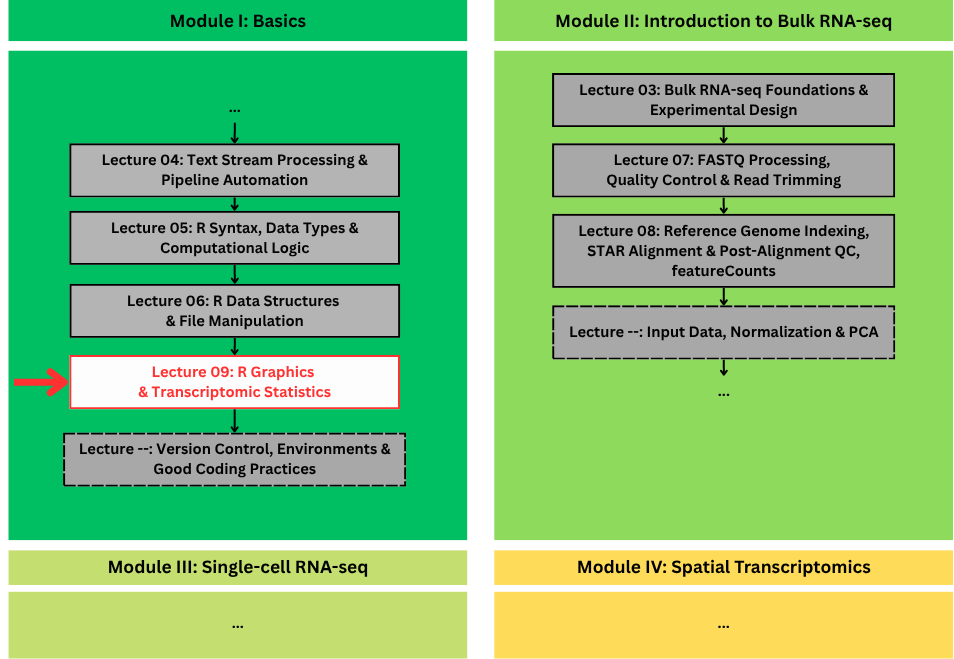{fig-align="center" width="60%"}

---

## 🗺️ Where Lecture 9 sits

- **Lectures 1, 2, 4**: course intro, Linux, text streams, pipelines
- **Lectures 5, 6**: R syntax, data types, data structures — the R track
- **Lectures 3, 7, 8**: bulk RNA-seq — design, FASTQ QC, STAR alignment,
  featureCounts
- **Lecture 9: R Graphics &amp; Transcriptomic Statistics** — statistics that
  turn numbers into claims, plots that show them.

---

## 1. Review from Lecture 8

::: {.agenda data-section="1"}
:::

---

### ⚡ Q1: Find the counts for gene `X` — which line gets the row?

:::: {.columns}

::: {.column width="58%"}
```{webr-r}
#| autorun: true

# rows = genes, columns = samples
df <- data.frame(
  gene   = c("TP53", "BRCA1", "X"),
  Tumor  = c(1200, 450, 89),
  Normal = c(3300, 2100, 990)
)
df
```
:::

::: {.column width="42%"}
- **A.** `df[2, ]`
- **B.** `df[3, ]`
- **C.** `df[, 2]`
- **D.** `df$X`
:::

::::

---

### ✅ **B** — `df[3, ]` is the whole row for gene `X`

```{webr-r}
df[3, ]
```

- **A** is the **2nd row** — `BRCA1`, not `X`. The comma is right; the number is the wrong gene.
- **C** is the **2nd column** as a vector: `1200 450 89`. The comma comes *before* the `2`.
- **D** is the **quiet trap**: `$` takes a *column by name*, and there is no column called `X`, so it returns `NULL` with no error.

::: {.callout-tip}
The way you do it in real code: `df[df$gene == "X", ]`. Row names are not row numbers, so index by a condition.

A data frame gives you a row only when the **comma** is there: `[row, column]`
:::

---

### ⚡ Q2: Which line gets the counts, not the wrapper?

:::: {.columns}

::: {.column width="58%"}
```{webr-r}
#| autorun: true

qc_report <- list(
  sample_name = "Visium_HD_01",
  umi_counts  = c(200, 450, 12, 90, 800)
)
qc_report
```
:::

::: {.column width="42%"}
- **A.** `qc_report["umi_counts"]`
- **B.** `qc_report[["umi_counts"]]`
- **C.** `qc_report$sample_name`
- **D.** `qc_report[1]`
:::

::::

---

### ✅ **B** — `[[ ]]` unwraps, `[ ]` keeps the wrapper

:::: {.columns}

::: {.column width="45%"}
```{webr-r}
qc_report["umi_counts"]
```

```{webr-r}
qc_report[["umi_counts"]]
```
:::

::: {.column width="55%"}
- **A** single brackets keep the wrapper: the printout starts with `$umi_counts`, then the numbers.
- **C** `$` picks by name, and `sample_name` is a string: `chr "Visium_HD_01"`, not the counts.
- **D** `[1]` picks by position *and* keeps the wrapper: `List of 1` with `$sample_name`.
:::

::::

:::{.callout-note}
Use `[[ ]]` when you want the value, `[ ]` when you want a smaller list.

`str()` shows the difference immediately.
:::

---

### ⚡ Q3: Which line averages only the measured spots?

:::: {.columns}

::: {.column width="42%"}
```{webr-r}
#| autorun: true

umi <- c(1200, NA, 450, 800, 90)
mean(umi)
```
:::

::: {.column width="58%"}
- **A.** `mean(umi, rm.na = TRUE)`
- **B.** `mean(umi, na.rm = TRUE)`
- **C.** `mean(!is.na(umi))`
- **D.** `mean(umi, na.rm = NA)`
:::

::::

---

### ✅ **B** — the flag is spelled `na.rm`, and it must be `TRUE`

:::: {.columns}

::: {.column width="45%"}

```{webr-r}
mean(umi, na.rm = TRUE)
```

```{webr-r}
mean(umi, rm.na = TRUE)
```

```{webr-r}
mean(!is.na(umi))
```

```{webr-r}
mean(umi, na.rm = NA)
```
:::

::: {.column width="55%"}
- **A** `mean()` reads `na.rm`. `rm.na` lands in `...` and is ignored, so the `NA` stays and the result is `NA`.
- **C** `!is.na(umi)` is a logical vector: `TRUE TRUE FALSE TRUE TRUE`. Averaging it gives the *share* of measured spots, `0.8`, not the counts.
- **D** the flag has to be `TRUE`. `isTRUE(NA)` is `FALSE`, so nothing is dropped and the answer stays `NA`.
:::

::::

Count the holes first, then decide. `na.rm = TRUE` is a choice you report, not a default.

---

### A number means nothing on its own

::: {.quote}
A p-value, not a p-list.
:::
<div class="credit">— the statistician's rule of thumb, on this deck's own theme</div>

One count answers one question. Statistics is what lets us say:

- what the data **looks like** (descriptive)
- what the data is **likely to be** (distribution)
- what we can **claim** from it (inference)

::: {.slide-kicker}
Today: 8 tools, in the order you use them.
:::

---

### 🧰 The statistician's toolbox

1. **Describe**: mean, median, sd, IQR
2. **Observe the shape**: is it a normal distribution?
3. **Check normality**: Shapiro-Wilk, Q-Q plot
4. **Choose a test**: parametric or non-parametric
5. **Read the p-value**
6. **Correct for multiple testing**
7. **Correlate and regress**
8. **Plot it** — devices, ggplot2, publication figures

---

## 2. Descriptive Statistics

::: {.agenda data-section="2"}
:::

---

### 🎯 The problem: seven spots — how do you describe them?

:::: {.columns}

::: {.column width="50%"}
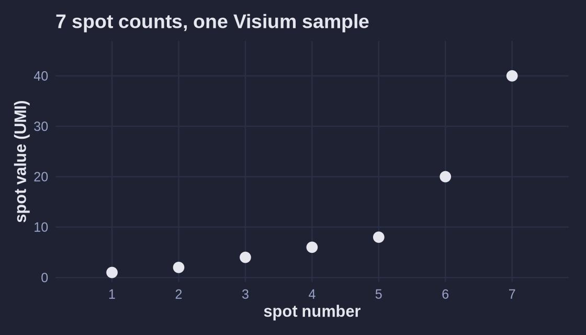{fig-align="center" width="100%"}
:::

::: {.column width="50%"}

```{webr-r}
#| autorun: true

# UMI counts: 7 Visium spots, one sample
counts <- c(1, 2, 4, 6, 8, 20, 40)
counts
```

:::

::::

- **what's the range of our data?** — the span
- **what is a typical spot?** — the average
- **how spread out are the counts?** — the spread

---

### The Range — min to max

:::: {.columns}

::: {.column width="55%"}
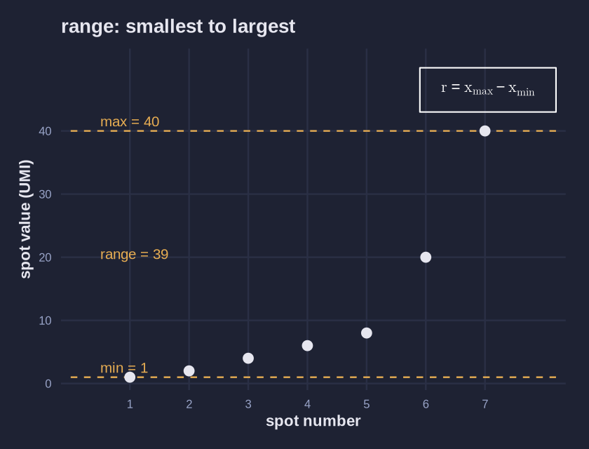{fig-align="center" width="100%"}
:::

::: {.column width="45%"}

```{webr-r}
range(counts)
```

```{webr-r}
min(counts)
```

```{webr-r}
max(counts)
```

:::

::::

---

### The Center — where the middle is

:::: {.columns}

::: {.column width="55%"}
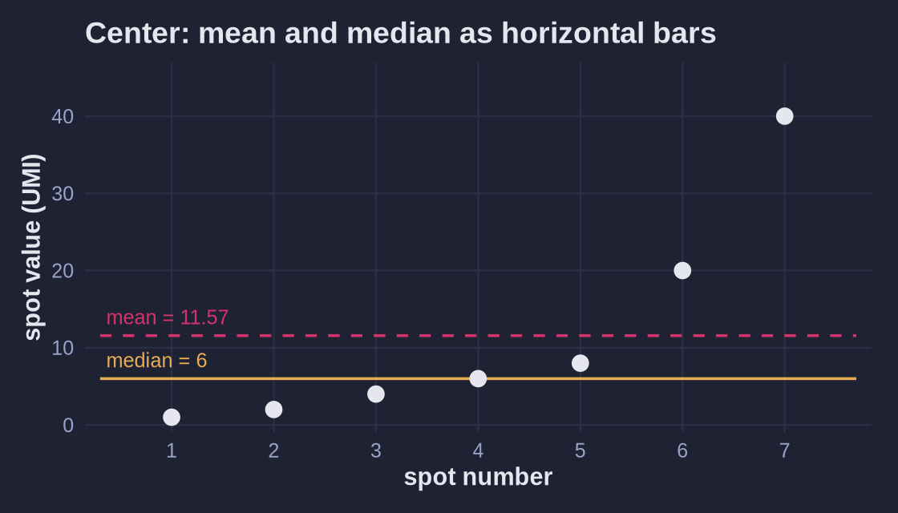{fig-align="center" width="100%"}
:::

::: {.column width="45%"}
- **mean**: add them, divide by how many

```{webr-r}
mean(counts)
```

- **median**: the middle value, after sorting

```{webr-r}
median(counts)
```

:::


::::

---

### Quartiles — the median of each half

:::: {.columns}

::: {.column width="50%"}
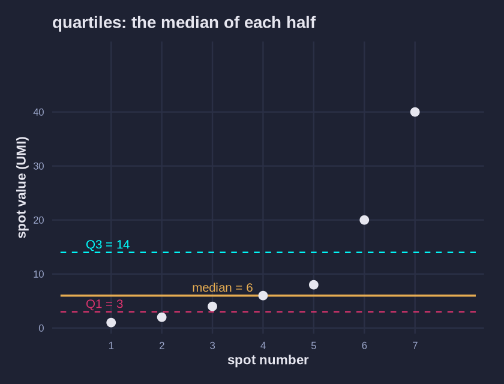{fig-align="center" width="100%"}
:::

::: {.column width="50%"}
- **Q1**: the median of the lower half
```{webr-r}
median(counts[1:4])
```

- **Q3**: the median of the upper half

```{webr-r}
median(counts[4:7])
```

::: {.small}
> Two ways to choose the halves. **Keeping the median** in both halves gives 3 and 14 — what R's `quantile()`, `fivenum()` and `boxplot()` report. **Excluding the median** is the calculator rule: lower half 1, 2, 4 → 2, upper half 8, 20, 40 → 20.
:::

:::

::::


---

### Interquartile range (IQR) — the middle half

:::: {.columns}

::: {.column width="55%"}
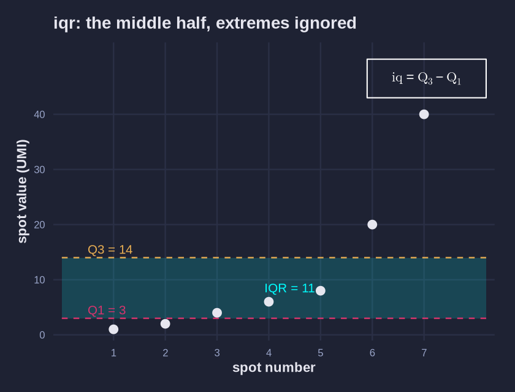{fig-align="center" width="100%"}
:::

::: {.column width="45%"}

- **Q1**: the lowest 25% of the spots

```{webr-r}
quantile(counts, 0.25)
```

- **Q3**: the highest 25% of the spots

```{webr-r}
quantile(counts, 0.75)
```

- **IQR**: Q3 − Q1 — the spread of the middle half

```{webr-r}
IQR(counts)
```

:::

::::

---

### The Spread — how far it is from the center

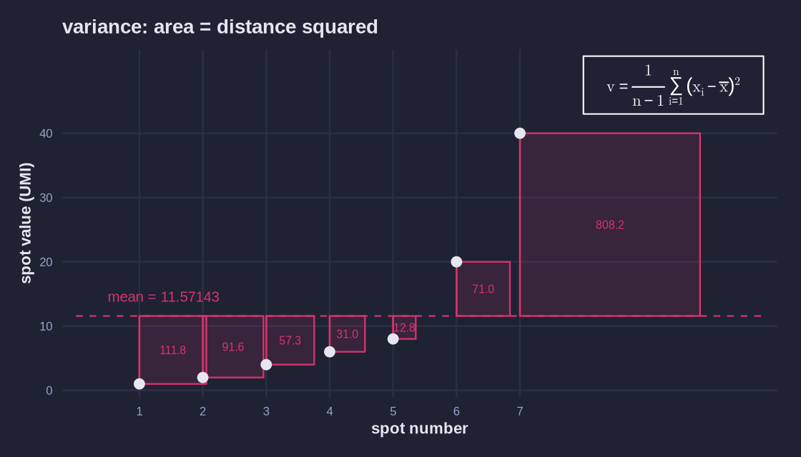{fig-align="center" width="100%"}


---

### Variance — spread distance in squared units

:::: {.columns}

::: {.column width="45%"}
$$v = \frac{1}{n-1}\sum_{i=1}^{n}(x_i - \bar{x})^2$$

:::

::: {.column width="55%"}

```{webr-r}
counts <- c(1, 2, 4, 6, 8, 20, 40)
var(counts)
```

:::

::::


Why variance?

- **Tests** need variance: t-tests, DE models,...
- Make counts usable for **clustering** and **PCA**.
- Variable-gene step uses genes with the **highest variance**


---

### 📏 Standard deviation — the deviation from the mean

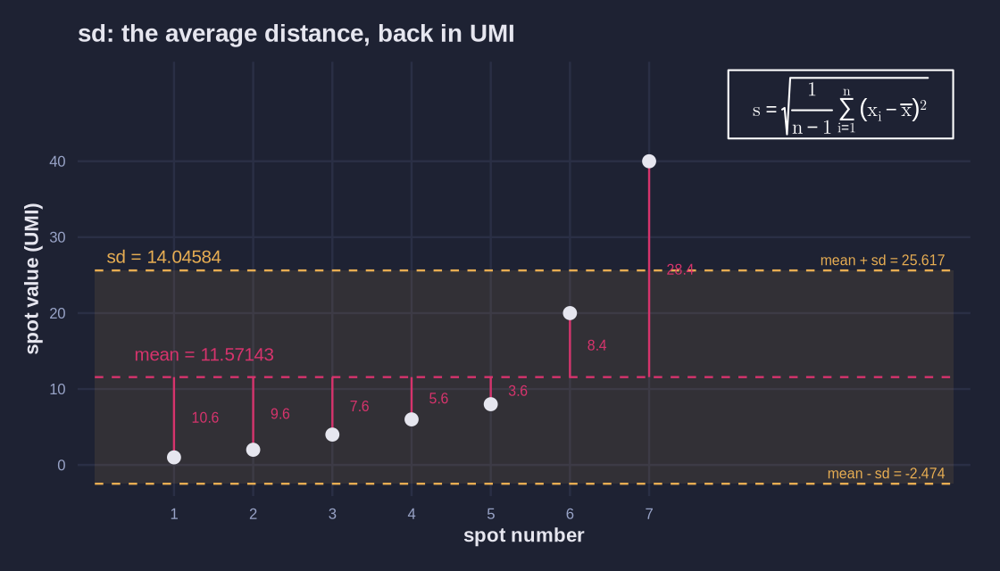{fig-align="center" width="100%"}

---

### 📏 sd — the average distance from the mean

:::: {.columns}

::: {.column width="45%"}
$$s = \sqrt{\frac{1}{n-1}\sum_{i=1}^{n}(x_i - \bar{x})^2}$$
:::

::: {.column width="55%"}
```{webr-r}
counts <- c(1, 2, 4, 6, 8, 20, 40)
sd(counts)
```
:::

::::

Why standard deviation?

- **the typical range** — sd sets the band `mean − sd` to `mean + sd`; inside = typical, outside = stands out → **p-value**
- **the summary table** — every group reports **mean ± sd**, and **Shapiro-Wilk** tests the normal distribution sd defines

---

### 🔍 variance vs sd — same information, two units

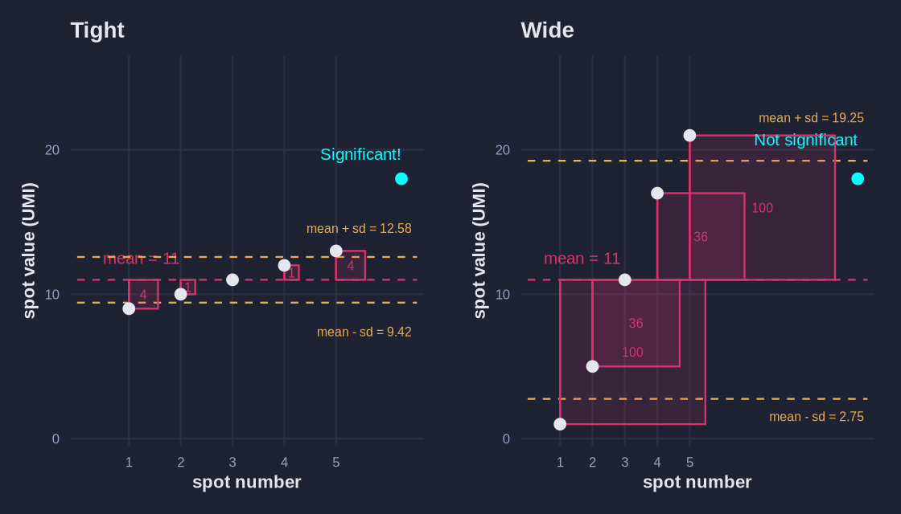{fig-align="center" width="100%"}

**⚖️ sd is what decides a claim**

---

### ⚡ Q1: Seven tumor spots, mean 11.57. You want one number saying how typical a spot is, in UMI counts. Which?

:::: {.columns}

::: {.column width="55%"}
```{webr-r}
#| autorun: true

counts <- c(1, 2, 4, 6, 8, 20, 40)
```
:::

::: {.column width="45%"}
- **A.** `var(counts)`
- **B.** `sd(counts)`
:::

::::

---

### ✅ **B** — sd is the spread in the **same units as the counts**

:::: {.columns}

::: {.column width="45%"}

```{webr-r}
#| autorun: true
sd(counts)
var(counts)
```

```{webr-r}
#| autorun: true
mean(counts) + sd(counts)
mean(counts) - sd(counts)
```
:::

::: {.column width="55%"}
- **B** sd is in counts, so `mean ± sd` is a band the reader can check against the dots.
- **A** variance is squared counts — for tests and models, not for reporting.
:::

::::

Report the sd, keep the variance for the model.

---

### ⚡ Q2: `mean(tight)` and `mean(wide)` are both 11. Which line shows the groups are different?

:::: {.columns}

::: {.column width="42%"}
```{webr-r}
#| autorun: true

tight <- c(9, 10, 11, 12, 13)
wide  <- c(1, 5, 11, 17, 21)

mean(tight)
mean(wide)
```
:::

::: {.column width="58%"}
- **A.** `median(tight)` vs `median(wide)`
- **B.** `sd(tight)` vs `sd(wide)`
- **C.** `length(tight)` vs `length(wide)`
- **D.** `sum(tight)` vs `sum(wide)`
:::

::::

---

### ✅ **B** — same centre, five times the spread

:::: {.columns}

::: {.column width="45%"}

```{webr-r}
#| autorun: true

sd(tight)
sd(wide)
```

```{webr-r}
#| autorun: true

median(tight)
median(wide)
```

```{webr-r}
#| autorun: true

length(tight)
length(wide)
```
:::

::: {.column width="55%"}
- **A** both medians are 11, so the middle does not tell the groups apart.
- **C** both groups have 5 spots; the same n says nothing about spread.
- **D** both sums are 55, so the total is identical too.
- **B** sd is the only number that separates them: a tight group is repeatable, a wide group is *noisy*
:::

::::

::: {.callout-note}
The mean is the same number; the data is not the same data.
:::

---

### ⚡ Q3: One 500 joins nine small counts. Which number moves most?

:::: {.columns}

::: {.column width="55%"}

```{webr-r}
#| autorun: true

skew <- c(2, 3, 4, 5, 6, 7, 8, 9, 10, 500)
```
:::

::: {.column width="45%"}
- **A.** the median
- **B.** the mean
- **C.** both move by the same amount
- **D.** neither: the centre is fixed
:::

::::

---

### ✅ **B** — the mean carries 500, the median ignores its size

:::: {.columns}

::: {.column width="45%"}

```{webr-r}
#| autorun: true

mean(skew)
median(skew)
```
:::

::: {.column width="55%"}
- **A** the median sees only the middle two positions: 6.5.
- **C** the mean absorbs 500, the median gains nothing — not symmetric.
- **D** the centre moves by 48.9. That gap is the finding.
- **B** the mean adds every value, so 500 enters as 500 / 10 = 50 per spot.
:::

::::

::: {.callout-tip}
**Report both.** If mean and median sit far apart, that gap is the finding.
:::

---

### Too lazy? R got you covered!

```{webr-r}
summary(counts)
```

---

### ✅ Summary

- **three questions**: the span, the typical spot, the spread
- **range** = min to max · **mean** = add and divide · **median** = middle
- **quartiles** = median of each half · **IQR** = the middle 50%
- **variance** = squared units, for tests · **sd** = the data's units, for reporting
- **mean + median together** show the shape — one outlier moves the mean
- **summary()** prints the whole set

---

## 3. Shape, Distribution &amp; Normality

::: {.agenda data-section="3"}
:::

---

### 🎯 The problem: same mean, three different tumors

Three tumors can have the same average UMI count and be completely
different data.

:::: {.columns}

::: {.column width="33%"}
```{webr-r}
#| autorun: true

tumor1 <- c(1, 3, 4, 5, 6, 6, 6, 7, 8, 9, 11)
mean(tumor1)
median(tumor1)
```
:::

::: {.column width="33%"}
```{webr-r}
#| autorun: true

tumor2 <- c(1, 2, 3, 4, 4, 5, 5, 6, 6, 7, 8, 9, 18)
mean(tumor2)
median(tumor2)
```
:::

::: {.column width="33%"}
```{webr-r}
#| autorun: true

tumor3 <- c(1, 2, 3, 5, 7, 8, 8, 8, 8, 8, 8)
mean(tumor3)
median(tumor3)
```
:::

::::

---

### 🧐 sd ranks the spread, not the shape

:::: {.columns}

::: {.column width="45%"}
```{webr-r}
#| autorun: true

sd(tumor1)
sd(tumor2)
sd(tumor3)
```
:::

::: {.column width="55%"}
- sd sorts the three by spread: `tumor2` widest, `tumor3` tightest.
- sd is one number — how far the counts sit from the mean, not **where** they sit.
- `tumor3` has a tail to the left, and sd only reports that it is tight.
:::

**So what should we do?**

::::

---

### The shape is the information

It matters because the most common tests **assume** this shape. If the data
is normally distributed, those tests work. If it is not, those tests can lie.

::: {.callout-note}
UMI counts are usually **not** normally distributed: many low-count spots, a few
very high ones. Long tail on the right.
:::

---

### Symmetric — `tumor1`

Many measurements pile up in the middle and thin out evenly on both sides. 

That shape is called **normal** — the bell curve.


:::: {.columns}

::: {.column width="55%"}
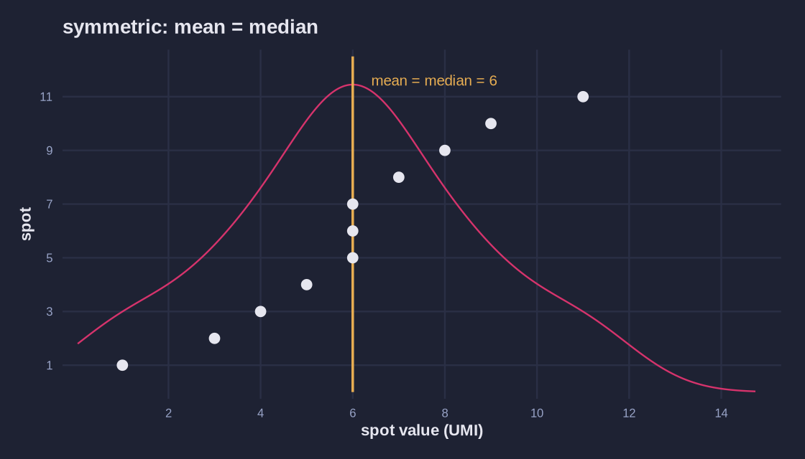{fig-align="center" width="100%"}
:::

::: {.column width="45%"}
- the counts sit evenly on both sides of the middle
- **mean ≈ median** — the two lines land on the same spot

```{webr-r}
#| autorun: true

mean(tumor1)
median(tumor1)
```

:::

::::

---

### Right-skewed — `tumor2`

:::: {.columns}

::: {.column width="55%"}
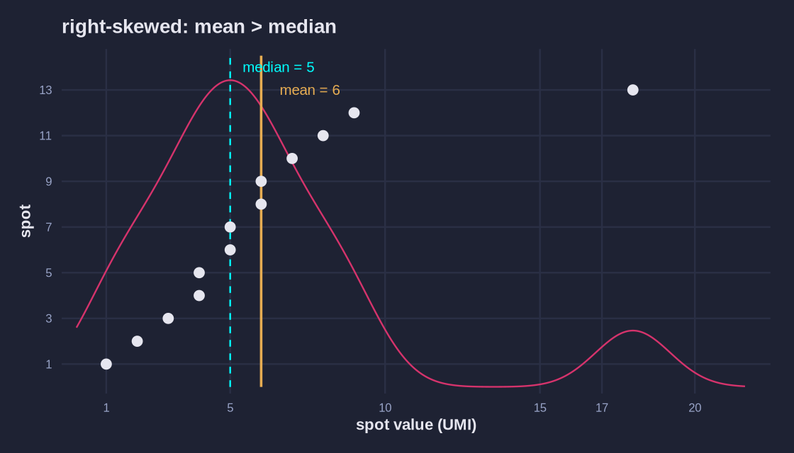{fig-align="center" width="100%"}
:::

::: {.column width="45%"}
- twelve counts climb from 1 to 9, one count sits far above
- the high count drags the mean up — the median stays with the pile
- **mean &gt; median**

```{webr-r}
#| autorun: true

mean(tumor2)
median(tumor2)
```

:::

::::

---

### Left-skewed — `tumor3`

:::: {.columns}

::: {.column width="55%"}
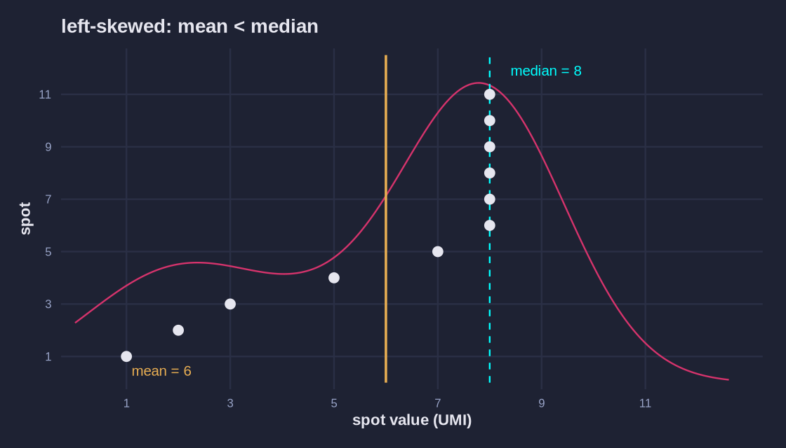{fig-align="center" width="100%"}
:::

::: {.column width="45%"}
- ten counts pile at the high end, a low tail runs to the left
- the low tail drags the mean down — the median stays with the pile
- **mean &lt; median**

```{webr-r}
#| autorun: true

mean(tumor3)
median(tumor3)
```

:::

::::

---

### Shapiro-Wilk test

One number, one p-value:

- **p &gt; 0.05** → no **evidence against normal**. Treat it as a **normal distribution**.
- **p ≤ 0.05** → the data is **not normal**. **Do not use normal-distribution tests.**

:::: {.columns}

::: {.column width="33%"}
```{webr-r}
#| autorun: true

shapiro.test(tumor1)
```
:::

::: {.column width="33%"}
```{webr-r}
#| autorun: true

shapiro.test(tumor2)
```
:::

::: {.column width="33%"}
```{webr-r}
#| autorun: true

shapiro.test(tumor3)
```
:::

::::

::: {.callout-note}
A Q-Q plot is the visual version: points curving away at the end mean a real tail.
:::

---

### A Q-Q plot

```{webr-r}

qqnorm(tumor1)
qqline(tumor1)
```


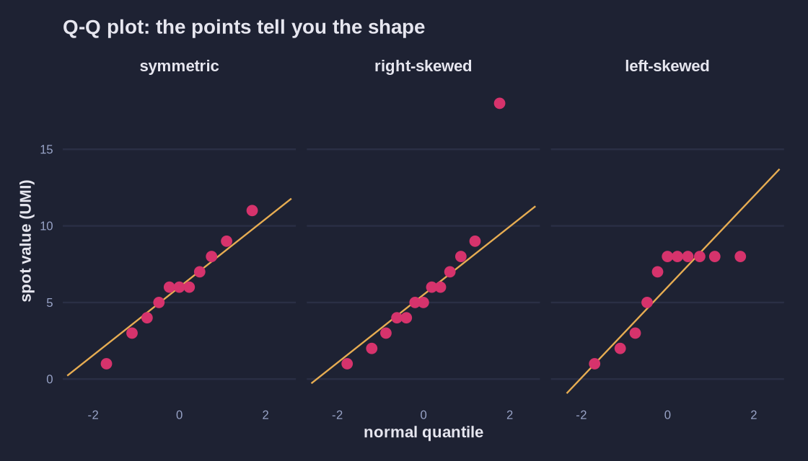{fig-align="center" width="100%"}

**Read the shape from the plot** before choosing a test.


---

### ✅ Summary

- sd ranks the **spread**, not the **shape**
- shape = mean vs median: **mean ≈ median** symmetric · **mean &gt; median** right · **mean &lt; median** left
- the common tests **assume** the normal shape — UMI counts are usually right-skewed
- Shapiro-Wilk gives the number, the Q-Q plot the picture — same check
- p &gt; 0.05 → treat as normal · p ≤ 0.05 → not normal, use the rank test

---

## 4. p-value &amp; Statistical Tests

::: {.agenda data-section="4"}
:::

---

### What a p-value is

:::: {.columns}

::: {.column width="65%"}


>...the **p-value** is the **probability** of obtaining test results **at least as extreme as the result** actually observed, under the assumption that the null hypothesis is correct.

:::

::: {.column width="35%"}

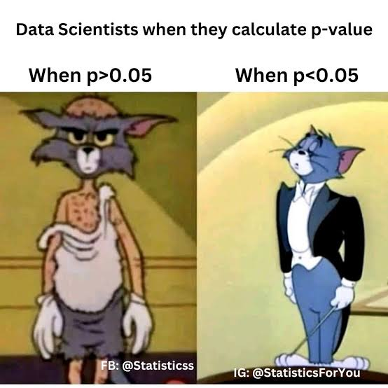{width="65%"}

<div class="credit">FB: @Statisticss · IG: @StatisticsForYou — image via Google Images (<a href="https://encrypted-tbn0.gstatic.com/images?q=tbn:ANd9GcRXpp3pINnzFSvCjsztyHpUuEUrASfQBQ7KrqcRq2yvQBfF1ofyayYX-v_O&s=10">thumbnail source</a>)</div>

:::

::::

::: {.callout-important}
p is **not** the probability the hypothesis is true. 

It answers "***what are the chances of getting a result this extreme by pure randomness?***".
:::

---

### p from 0.5 down to 0.001

- p = 0.5 → this result is common under no effect. Not evidence.
- p = 0.1 → 1 in 10 under no effect. Not evidence.
- **p = 0.05** → the decision line. 5 in 100 under no effect.
- p = 0.03 → if the groups were truly the same, this happens about 3 times in 100
- p = 0.01 → 1 in 100 under no effect.
- p = 0.001 → 1 in 1,000 under no effect.

---

### ⚠️ The problem: 20,000 genes

- A gene with no difference still gets a p-value. p is defined under no effect,
  so a result this extreme happens 5 times in 100.

```{webr-r}
#| autorun: true
strong <- rep(1e-06, 1000)
medium <- rep(0.002, 2000)
boring <- rep(0.6, 17000)
all_pvals <- c(strong, medium, boring)

20000 * 0.05
```

Test 20,000 genes at p &lt; 0.05, and **1,000 will pass by chance alone**. Not good.

::: {.callout-important}
Every transcriptomics analysis tests thousands of features. Without a
correction, you are not discovering — you are sorting noise.
:::

---

### The new threshold — Why divide by 20,000?

- 0.05 = 1 in 20 fluke chance for one test
- 20,000 = number of tests
- 1 in 20 ÷ 20,000 = 1 in 400,000: the whole analysis keeps 1 in 20

```{webr-r}
#| autorun: true
threshold <- 0.05 / 20000
threshold
```

---

### Bonferroni — strict

```{webr-r}
#| autorun: true
bf_pass <- p.adjust(all_pvals, 
          method = "bonferroni") < 0.05
sum(bf_pass)
```


::: {.callout-tip}
Simple BUT **very hard to pass**. 

It kills real findings too.
:::

---

### Benjamini-Hochberg — the usual choice

Control the **false discovery rate** (FDR): the share of your "significant"
list that is noise.

```{webr-r}
#| autorun: true
bh_pass <- p.adjust(all_pvals, 
          method = "BH") < 0.05
sum(bh_pass)
```

::: {.callout-important}
**BH** is the **standard** in transcriptomics.
:::


---

### Where do p-values come from?

p is not a number you choose. It is the **output of a test**.

Two decisions come before the test:

- **The unit** — what varies independently
- **The test** — the question, and the shape of the data

---

### ⚠️ The problem: 80 spots, 4 patients

:::: {.columns}

::: {.column width="70%"}

```{webr-r}
#| autorun: true

# expression of one gene, Visium lung cancer — one value per spot
p1 <- c(27,27,26,29,28,27,29,29,28,30)  # patient 1 · control

p2 <- c(rep(17,25), 18,19,20,21,22)     # patient 2 · control

p3 <- c(25,27,25,28,27,26,27,28,26,27,  # patient 3 · tumor
        29,27,28,28,29,28,29,27,29,28,
        28,29,30,28,29,30,28,30,30,32)
        
p4 <- c(rep(17,7), 23,29,35)            # patient 4 · tumor

x <- c(p1, p2, p3, p4)
```

:::

::: {.column width="30%"}

The question: **is this gene higher in tumor?**

The data we have is spots. The claim we want is about patients.

:::

::::

---

### Every test in the book

:::: {.columns}

::: {.column width="25%"}

- Student t
- Welch t
- paired t
- Wilcoxon
- Wilcoxon signed-rank
- sign test
- bootstrap
- permutation

:::

::: {.column width="25%"}

- ANOVA
- Welch ANOVA
- Kruskal-Wallis
- Friedman
- MANOVA
- chi-square
- Fisher
- G-test

:::

::: {.column width="25%"}

- Poisson
- negative binomial
- Pearson
- Spearman
- Kendall
- linear regression
- logistic regression

:::

::: {.column width="25%"}

- Levene
- Bartlett
- Fligner
- Kolmogorov-Smirnov
- DESeq2
- edgeR
- limma-voom
- ...

:::

::::

::: {.callout-note}
Every name is a valid test. Most of them do not answer this question, and the question itself does not say which one to run.
:::

---

### An example

```{webr-r}
control <- c(p1, p2)   # patient 1 (normal) + patient 2 (skewed), 40 spots
tumor   <- c(p3, p4)   # patient 3 (normal) + patient 4 (skewed), 40 spots
t.test(tumor, control)
```

**p-value = 1.772e-07 — far below 0.05, so the result is significant. Means 26.200 vs 20.125, a difference of 6.075.**

You reported this gene expressed **MORE** in tumor cohorts.

---

### In reality, the pooled p is a pitfall

```{webr-r}
#| autorun: true

c(mean(p1), mean(p2), mean(p3), mean(p4))
```

Patient 1 and patient 3 sit at the same level: **28.00** and **28.07**. Run on the
4 patients, **p = 0.831**.

::: {.callout-important}
Spots are not independent observations. Pooling them makes the sample size huge and the p-value tiny — the number got smaller, the claim did not get stronger. 

The test has to be run on the unit the experiment was built on.
:::

---

### Normal distribution tests, and their backup

| Question | Normal distribution | Any data |
|---|---|---|
| 2 groups | t-test | Wilcoxon |
| 2 groups, same subject twice | paired t | Wilcoxon signed-rank |
| 3+ groups | ANOVA | Kruskal-Wallis |

**Parametric** = assumes the normal distribution.

**Non-parametric** = assumes nothing. Uses ranks, not values.

---

### The data — check for distribution

:::: {.columns}

::: {.column width="25%"}
```{webr-r}
#| autorun: true
shapiro.test(p1)
```
:::

::: {.column width="25%"}
```{webr-r}
#| autorun: true
shapiro.test(p2)
```
:::

::: {.column width="25%"}
```{webr-r}
#| autorun: true
shapiro.test(p3)
```
:::

::: {.column width="25%"}
```{webr-r}
#| autorun: true
shapiro.test(p4)
```
:::

| | `p1` | `p2` | `p3` | `p4` |
|---|---|---|---|---|
| condition | control | control | tumor | tumor |
| distribution | normal | skewed right | normal | skewed right |
| mean | 28.00 | 17.50 | 28.07 | 20.60 |
| median | 28 | 17 | 28 | 17 |

`p2` and `p4` are right-skewed: their hot spots drag the mean right of the median.

::::

---

### 2 groups, different conditions — treatment vs control

:::: {.columns}

::: {.column width="50%"}

**Normal data** → t-test

```{webr-r}
t.test(p3, p1)
```

:::

::: {.column width="50%"}

**Any data** → Wilcoxon

```{webr-r}
wilcox.test(p4, p2)
```

:::

::::

Both say no difference.

---

### A gap is not enough — spread decides

:::: {.columns}

::: {.column width="50%"}

```{webr-r}
#| autorun: true

t.test(p4, p2)
```

:::

::: {.column width="50%"}

```{webr-r}
#| autorun: true

t.test(p2, p3)
```

:::

::::

| pair | gap | sd | t | p |
|---|---|---|---|---|
| p4 vs p2 | 3.1 | 6.45 · 1.28 | 1.51 | **0.164** |
| p2 vs p3 | 10.6 | 1.28 · 1.55 | −28.77 | **3.205881e-35** |

::: {.callout-important}
A statistic is a **signal-to-noise** judgement. More spots shrink the
noise, so a smaller gap can become convincing.
:::

---

### 2 groups, same subject — pre vs post

Same patient, biopsied before and after treatment: 10 spots.

```{webr-r}
px_pre  <- p4                                         # before
px_post <- c(16, 14, 14, 15, 16, 13, 15, 22, 28, 33)  # after
```

:::: {.columns}

::: {.column width="50%"}

```{webr-r}
t.test(px_post, px_pre, paired = TRUE)
```

:::

::: {.column width="50%"}

```{webr-r}
t.test(px_post, px_pre)
```

:::

::::

The same data answers two questions. Paired: **p = 0.0002025**. Unpaired:
**p = 0.5095**. Pairing removes the spot-to-spot spread, so the difference
carries more weight.

---

### 3+ groups — ANOVA

```{webr-r}
#| autorun: true

p5  <- c(19,19,18,21,20,19,21,21,20,22)  # patient 5 · tumor, normal

x   <- c(p1, p3, p5)
lab <- rep(c("p1", "p3", "p5"), c(10, 30, 10))
grp <- factor(lab) # categories, not text

summary(aov(x ~ grp))
```

All three are normal, so ANOVA is fair: **p < 2e-16**.

---

### 3+ groups — ANOVA: result and pairwise

:::: {.columns}

::: {.column width="50%"}

```{webr-r}
tapply(x, grp, mean)
```

Patients 1 and 3 express the gene at the same level (28.0 and 28.07); patient 5
expresses it lower (20.0).

:::

::: {.column width="50%"}

```{webr-r}
pairwise.t.test(x, grp, p.adjust.method = "none")
```

Patient 5 is below patients 1 and 3 (**p < 2e-16** each); patients 1 and 3 do not
differ (p = 0.9).

:::

::::

---

### 3+ groups — Kruskal-Wallis

```{webr-r}
#| autorun: true

all_spots  <- c(p1, p2, p3, p4)
all_lab    <- rep(c("p1", "p2", "p3", "p4"), c(10, 30, 30, 10))
all_labels <- factor(all_lab)

kruskal.test(all_spots, all_labels)
```

Patient 2 and patient 4 are skewed, so Kruskal-Wallis takes all four:
**p = 7.477e-12**.

---

### 3+ groups — Kruskal-Wallis: Which pair differs

:::: {.columns}

::: {.column width="50%"}

```{webr-r}
#| autorun: true

pairwise.wilcox.test(all_spots, all_labels, p.adjust.method = "none")
```

:::

::: {.column width="50%"}

- Insignificant pairs:
   - p1 vs p3
   - p2 vs p4
- Significant pairs:
   - p2 vs p1
   - p2 vs p3
   - p4 vs p1
   - p4 vs p3

:::

::::

---

### A category cannot be averaged

Every test so far takes **one number per spot**.

Some questions ask **how many** spots sit in a **category**.

---

### Counting data — the question

```{webr-r}
#| autorun: true

control_immune <- 40
control_other  <- 160
tumor_immune   <- 20
tumor_other    <- 180

immune_counts <- matrix(c(control_immune, control_other,
                          tumor_immune,  tumor_other), nrow = 2)
rownames(immune_counts) <- c("immune", "other")
colnames(immune_counts) <- c("control", "tumor")

immune_counts
```


The answer is a **table of counts**, not a mean.

Expected count = row total × column total ÷ total spots.

---

### Chi-square — big counts

```{webr-r}
chisq.test(immune_counts)
```

Expected counts stay above 5, so chi-square is valid: **p = 0.0078**.

---

### Fisher — small counts

:::: {.columns}

::: {.column width="50%"}

```{webr-r}
control_immune <- 2
control_other  <- 18
tumor_immune   <- 8
tumor_other    <- 2

small_counts <- matrix(c(control_immune, control_other,
                         tumor_immune,  tumor_other), nrow = 2)
rownames(small_counts) <- c("immune", "other")
colnames(small_counts) <- c("control", "tumor")

small_counts
```

:::

::: {.column width="50%"}

```{webr-r}
fisher.test(small_counts)
```

::: {.small}

**Null** — immune share equal in control and tumor.
**Expected counts** — the table that null predicts.
**p** — chance of a table this far off by randomness: **3 in 10,000**.

:::

:::

::::

Any expected count below 5, so Fisher:
**p = 2.91263e-04**.

---

### The decision flow

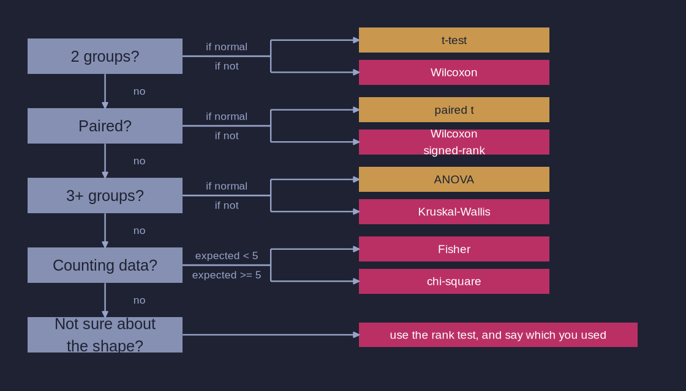{fig-align="center" width="100%"}

::: {.callout-tip}
Write the test name in the figure legend. A reader can then check whether
the claim is supported.
:::

---

### ⚡ Q1: `p2` is right-skewed, `p3` is normal. You want to compare them. Which test?

:::: {.columns}

::: {.column width="55%"}

```{webr-r}
#| autorun: true

shapiro.test(p2)
shapiro.test(p3)
```

:::

::: {.column width="45%"}

- **A.** t-test
- **B.** Wilcoxon

:::

::::

---

### ✅ **B** — `p2` fails the normal check, so the rank test

:::: {.columns}

::: {.column width="50%"}

```{webr-r}
#| autorun: true

wilcox.test(p2, p3)
```

:::

::: {.column width="50%"}

- **A** the t-test **assumes** the normal distribution — `p2`'s p = 1.924505e-09 says it is not normal
- **B** Wilcoxon uses **ranks** and assumes nothing: **p = 4.502014e-12** — the gap 17.5 vs 28.07 is real

:::

::::

Check the shape **before** choosing the test.

---

### ⚡ Q2: Both 5-spot groups pass Shapiro-Wilk (p = 0.97 and 0.81). Which test?

:::: {.columns}

::: {.column width="55%"}

```{webr-r}
#| autorun: true

five_spots <- c(28, 27, 29, 26, 30)
five_low   <- c(16, 18, 15, 17, 16)
shapiro.test(five_spots)
shapiro.test(five_low)
```

:::

::: {.column width="45%"}

- **A.** t-test
- **B.** Wilcoxon

:::

::::

---

### ✅ **A** — p &gt; 0.05 is no evidence **against** normal, so the t-test is fair

:::: {.columns}

::: {.column width="50%"}

```{webr-r}
#| autorun: true

t.test(five_spots, five_low)
```

:::

::: {.column width="50%"}

- **A** both groups pass: **p = 2.275325e-06** — the gap 28 vs 16.4 is real
- **B** the rank test is not needed here, and 5 vs 5 cannot go below **p = 0.0079**

:::

::::

Five spots cannot **prove** normal — p &gt; 0.05 means "not rejected". Say n = 5 in the figure.

---

### ⚡ Q3: 30 spots — immune 2 / other 18 in control, immune 8 / other 2 in tumor. Which test?

:::: {.columns}

::: {.column width="55%"}

```{webr-r}
#| autorun: true

quiz_small <- matrix(c(2, 18, 8, 2), nrow = 2)
rownames(quiz_small) <- c("immune", "other")
colnames(quiz_small) <- c("control", "tumor")
quiz_small
```

:::

::: {.column width="45%"}

- **A.** chi-square
- **B.** Fisher

:::

::::

---

### ✅ **B** — the smallest expected count is 3.33, below 5

:::: {.columns}

::: {.column width="50%"}

```{webr-r}
#| autorun: true

chisq.test(quiz_small)
```

:::

::: {.column width="50%"}

- **A** R warns `Chi-squared approximation may be incorrect` — the expected counts 6.67, 13.33, 3.33, 6.67 include a value below 5
- **B** Fisher counts the tables exactly: **p = 2.91263e-04**

:::

::::

Read the expected counts, not the observed counts, to choose.

---

### ⚡ Q4: `t.test(p4, p2)` gives **p = 0.164**. What does that say?

:::: {.columns}

::: {.column width="55%"}

```{webr-r}
#| autorun: true

t.test(p4, p2)
```

:::

::: {.column width="45%"}

- **A.** `p4` and `p2` are the same
- **B.** no evidence of a difference

:::

::::

---

### ✅ **B** — p is the chance of a gap this big **by randomness**, not proof of equality

:::: {.columns}

::: {.column width="50%"}

- gap **3.1** counts
- sd **6.45** in `p4`, **1.28** in `p2`
- n = 10 vs 30
- p = 0.164

:::

::: {.column width="50%"}

- **A** p &gt; 0.05 does **not** show the groups are equal — it shows the data is not evidence
- **B** a gap of 3.1 against a spread of 6.45 carries little weight; report the gap, the sd, and the test name

:::

::::

Say **no evidence**, never "no difference".

---

### ✅ Summary

- p = how surprising the data is, assuming no effect — p &gt; 0.05 = not evidence
- 20,000 genes → **always** correct — Bonferroni is strict, BH controls the share of noise
- the unit is what varies independently — count patients, not spots
- 2 groups → t / Wilcoxon · paired → paired t / signed-rank · 3+ groups → ANOVA / Kruskal · counting → chi-square (expected ≥ 5) / Fisher (expected &lt; 5)
- spread decides as much as the gap — name the test in the legend

---

## 5. Correlation &amp; Regression

::: {.agenda data-section="5"}
:::

---

### ⚠️ The problem: two numbers per spot

Every test so far compares **groups** — control vs tumor, pre vs post, category vs category.

Some questions have **no groups**: two measurements on the same spot, and the question is whether they move together.

:::: {.columns}

::: {.column width="50%"}

```{webr-r}
#| autorun: true

# expression of gene A, one value per spot
gene_a <- c(12, 15, 18, 22, 25, 31, 34, 40)
```

:::

::: {.column width="50%"}

```{webr-r}
#| autorun: true

# expression of gene B, the same 8 spots
gene_b <- c(9, 11, 14, 18, 21, 26, 29, 34)
```

:::

::::

---

### Pearson — a straight line

:::: {.columns}

::: {.column width="50%"}

```{webr-r}
cor.test(gene_a, gene_b, method = "pearson")
```

:::

::: {.column width="50%"}

r = 0.9994, p = 4.799893e-10 — `gene_b` tracks `gene_a` almost perfectly.

- **Pearson**: straight-line relationship

:::

::::

---

### Pearson visualization

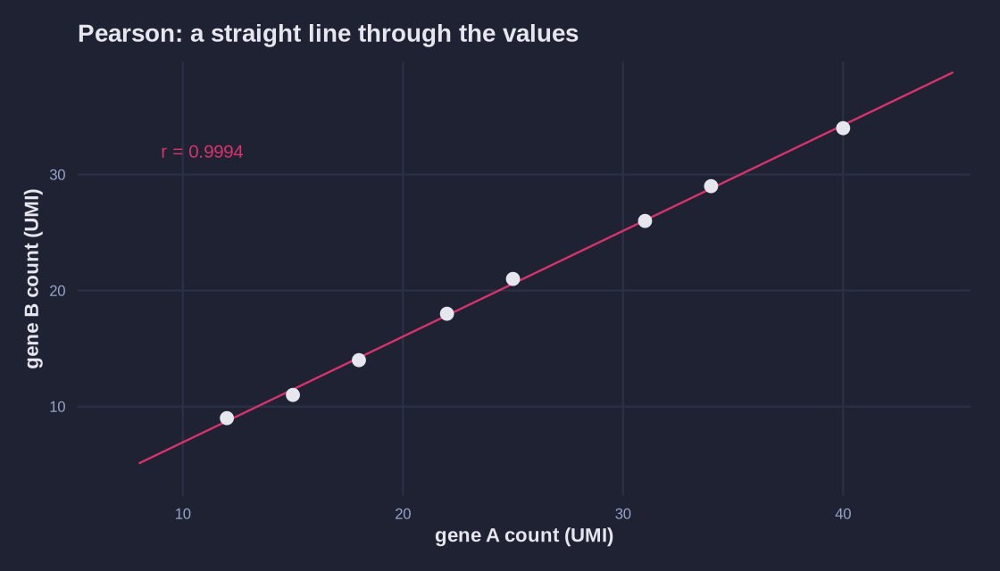{fig-align="center" width="100%"}

---

### Spearman — the rank order

:::: {.columns}

::: {.column width="50%"}

```{webr-r}
cor.test(gene_a, gene_b, method = "spearman")
```

:::

::: {.column width="50%"}

rho = 1, p = 4.960317e-05 — every spot keeps its order.

- **Spearman**: monotone — "as one goes up, so does the other"

:::

::::

---

### Spearman visualization

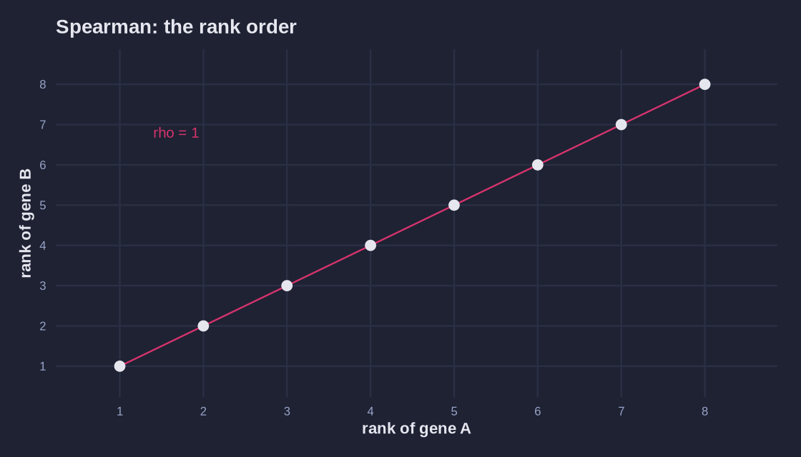{fig-align="center" width="100%"}

---

### The caveat: One hot spot breaks Pearson

```{webr-r}
# the last spot goes from 40 to 500 counts
gene_a_hot <- c(12, 15, 18, 22, 25, 31, 34, 500)

cor.test(gene_a_hot, gene_b, method = "pearson")
cor.test(gene_a_hot, gene_b, method = "spearman")
```

Pearson: r = 0.658, p = 0.076 — **not** significant.
Spearman: rho = 1, p = 4.960317e-05 — unchanged.

---

:::: {.columns}

::: {.column width="50%"}

- **Pearson** uses the **values** — one extreme count pulls the line

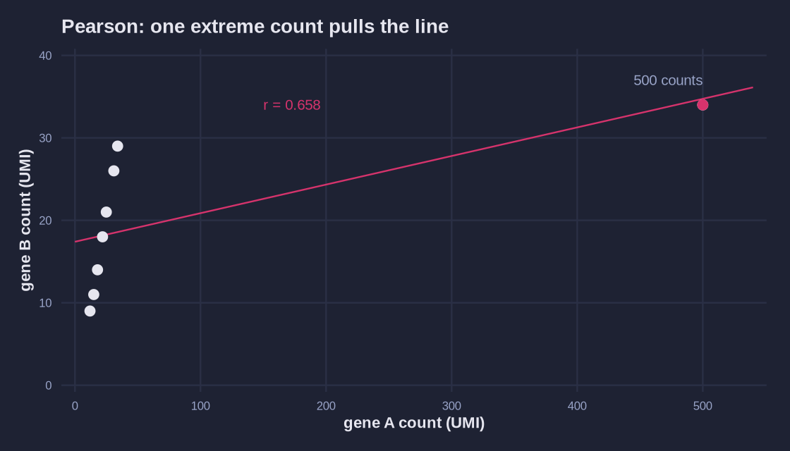{fig-align="center" width="100%"}

:::

::: {.column width="50%"}

- **Spearman** uses the **ranks** — the spot is still the highest, so the ordering is untouched

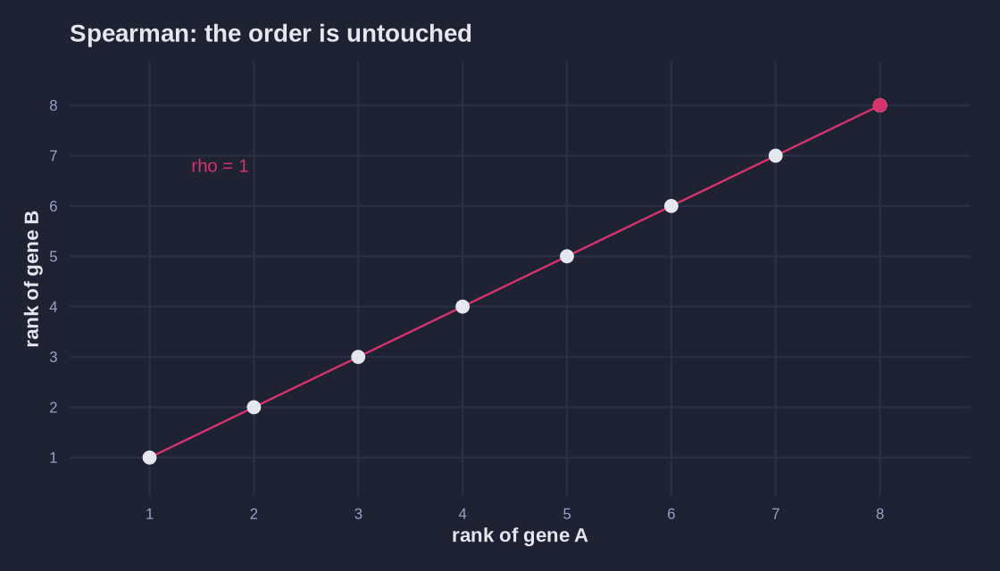{fig-align="center" width="100%"}

:::

::::

---

### Correlation is not causation

:::: {.columns}

::: {.column width="65%"}

tumor spots and normal spots can correlate in gene expression without one causing the other. 

Both may be driven by a third thing: hypoxia,
immune infiltration, tumor content.

:::

::: {.column width="35%"}

{fig-align="center"}

<div class="credit">Photo via X — <a href="https://pbs.twimg.com/media/FAW2hMeWEAAfcvm?format=webp&name=large">pbs.twimg.com/media/FAW2hMeWEAAfcvm</a></div>

:::

::::

::: {.callout-note}
Adjacent spots are *not* independent — they share tissue. A correlation
between them can be a neighbourhood effect, not a biological link.
:::

---

### How much does one move when the other rises?

Correlation answers **how well** the two counts move together — one number, no size.

The next question is **how much**: the counts `gene_b` gains when `gene_a` rises by one. Regression draws the line and reports the slope.

---

### Regression — a line through the data

:::: {.columns}

::: {.column width="50%"}

```{webr-r}
fit <- lm(gene_b ~ gene_a)
fit
```

:::

::: {.column width="50%"}

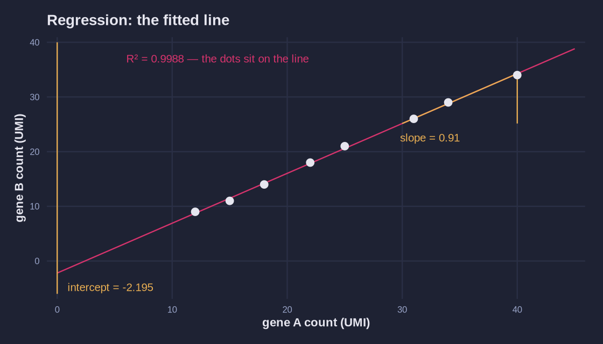{fig-align="center" width="100%"}

:::

::::

- **intercept** −2.195 — the value at 0 counts, not meaningful here
- **slope** 0.9115 — `gene_b` rises 0.91 counts per `gene_a` count, p = 4.799893e-10
- **R²** 0.9988 — the line explains 99.88% of the variation

---

### Reading a regression

```{webr-r}
summary(fit)
```

The slope is the claim. The intercept is usually plumbing.
The p-value tells you the slope is real; R² tells you the line fits.

---

### ✅ Summary

- Pearson = straight line · Spearman = ranks
- correlation ≠ causation
- regression = slope (the claim) + p (the confidence) + R² (the fit)
- spatial data is not independent — say what the correlation means

---

## 6. Statistics Practice

::: {.agenda data-section="6"}
:::

---

### 🖥️ Colab Session — Statistics Practice

Same as Lectures 5, 6 and 8: the practice runs in **Google Colab**, R runtime, nothing to install.

- Upload `counts_annotated.tsv` — Lecture 6's count matrix
- Open `lecture-09_statistics_practice.ipynb`, set `Runtime → Change runtime type → R`
- Run the cells in order: `Runtime → Run All`

The notebook takes the deck's tools to the real matrix: descriptive stats, shape check, per-gene tests, BH correction, correlation and regression.

---

### counts → QC → statistics → figure

The goal is **not the p-value**. It is **explaining your data to another person** —
and a **figure** does that faster than any table.

::: {.callout-important}
The figure is the **deliverable** — that is what sections 7-12 are for.
:::

---

## 7. How R Draws a Picture

::: {.agenda data-section="7"}
:::

---

### 🖼️ Every picture sits on a **device**

:::: {.columns}

::: {.column width="55%"}

```{webr-r}
png("qc.png", width = 900, height = 600)   # open
plot(1:5, c(2, 4, 6, 8, 10), pch = 16)   # draw
dev.off()   # close: the file is finished

# ggsave() does the same three steps for one ggplot figure:
# ggsave("volcano.pdf", p, width = 5.4, height = 3.4)
```

:::

::: {.column width="45%"}

- R draws on the **screen**, or into a **file**: `png()`, `pdf()`, `jpeg()`
- the pattern is always the same: **open, draw, close**
- `ggsave()` does all three for one ggplot figure

:::

::::

::: {.callout-note}
An unclosed device gives an empty file. "My PNG is blank" almost always means
a missing `dev.off()`.
:::

---

### 🧰 Tools you'll need

- **ggplot2**: draws figures from a data frame — dots, lines, bars, tiles
- **dplyr**: picks, filters, and summarises columns
- **tidyr**: reshapes between wide and long
- **ggridges**: ridgeline plots
- **RColorBrewer**: colour palettes

---

### 📖 Read any plot call with 3 questions

:::: {.columns}

::: {.column width="45%"}

1. **what data?** — the first argument
2. **what is drawn?** — the geometry: dots, lines, bars, boxes, tiles
3. **what maps where?** — which column becomes x, y, colour, size

:::

::: {.column width="55%"}

```{webr-r}
ggplot(
  spots,            # 1. data: 199 spots
  aes(x = x, y = y, # 3. mapping: position, and
  colour = expr)) + # colour = expression
  geom_point(size = 2.8) # 2. geometry: dots
```

:::

::::

::: {.callout-tip}
You do not have to remember the syntax to read it. Every call states its own
data, geometry, and mapping, in that order.
:::

---

### ⚡ Q1: 10 control spots and 10 tumor spots of one gene — is tumor higher?

:::: {.columns}

::: {.column width="55%"}

```{webr-r}
#| autorun: true

umi    <- c(p1, p4)                              # 20 spots
sample <- rep(c("control", "tumor"), each = 10)  # 10 + 10

boxplot(umi ~ sample)   # boxes, UMI by sample
```

:::

::: {.column width="45%"}

- **what data?** — 20 spots, one gene
- **what is drawn?** — boxes, one per group
- **what maps where?** — UMI on y, sample on x

:::

::::

---

### ✅ A1: control centre 28, tumor centre 17

- **control**: centre line 28, box 27-29, whiskers 26-30
- **tumor**: centre line 17, box 17-23, whiskers 17-29, and the spot at **35** outside the whisker
- `~` reads **"by"**: the value on the left, split by the groups on the right

---

### ⚡ Q2: You have never seen `geom_smooth()`. What can you guess?

### ✅ A2: The name tells you the layer

The verb prefixes are the whole vocabulary of ggplot2:

- `geom_*` — what gets **drawn** (point, line, col, boxplot, violin, tile)
- `scale_*` — how a **range** is set (limits, log axis, colour palette)
- `coord_*` — how the **plane** is shaped (equal, flipped)
- `facet_*` — how the figure is **split into panels**
- `labs()` / `theme()` — labels, styling

`geom_smooth()` draws a smoothed line. `scale_y_log10()` makes the y-axis log.

---

## 8. The Common Plots

::: {.agenda data-section="8"}
:::

---

### 📊 The plots you will read most

| call | what you see | the question it answers |
|---|---|---|
| `plot(x, y)` | dots | does y move with x? |
| `plot(x, y, type = "l")` | a line | how does y change across x? |
| `hist(v)` | stacked bars of counts | how is v spread? |
| `boxplot(v ~ g)` | boxes | centre and spread, per group |
| `geom_col()` | bars | one value per category |
| `geom_violin()` | violins | the whole distribution, per group |
| `geom_tile()` | coloured cells | one value per pair of labels |
| `geom_point()` + `coord_equal()` | a map | where values sit in space |

::: {.callout-note}
One table, eight plots. That covers most of what a transcriptomics paper
shows you. The rest is decoration on top of these.
:::

---

### ⚪ Dots and lines: relationship and trend

::::: {.columns}

::: {.column width="50%"}
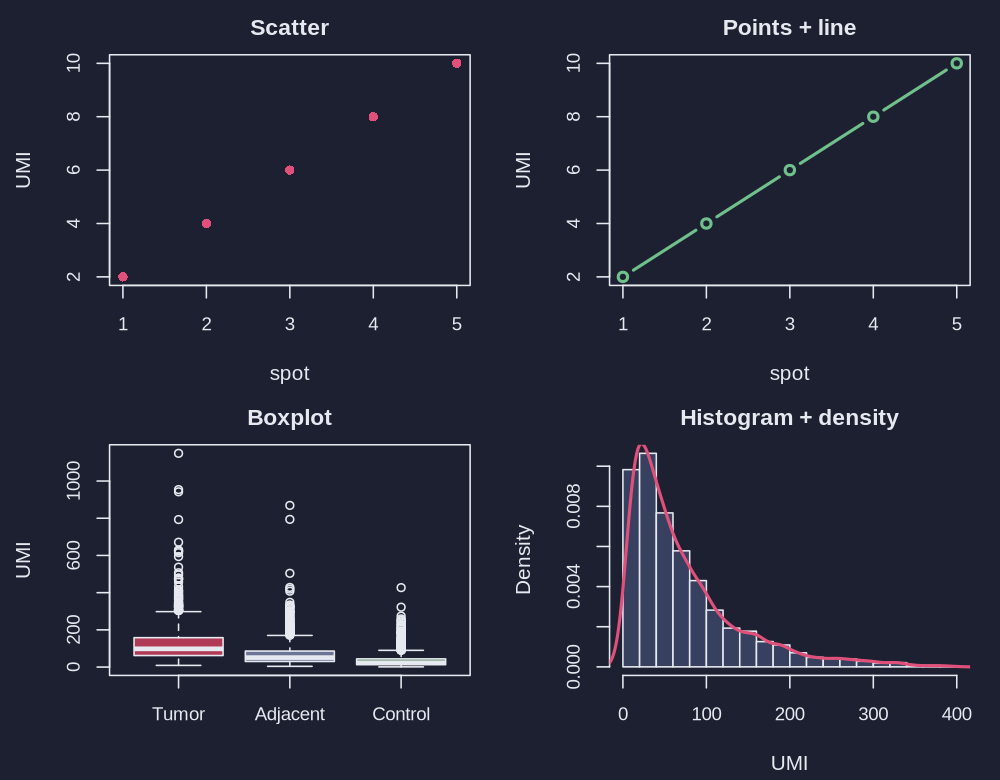{fig-align="center" width="100%"}
:::

::: {.column width="50%"}

- **dots**: 5 spots, UMI 2, 4, 6, 8, 10 — does y move with x?
- **line**: the same 5 numbers, joined. A line says *trend*, not *count*
- base R labels an axis with **the code itself** when you say nothing, so the
  second panel's y-axis would read `c(2, 4, 6, 8, 10)`. Say `ylab = "UMI"`

```{webr-r}
plot(1:5, c(2, 4, 6, 8, 10), pch = 16)          # dots
plot(1:5, c(2, 4, 6, 8, 10), type = "b",
     xlab = "spot", ylab = "UMI")                # dots + line
```
:::

:::::

---

### 📊 Bars, boxes, histograms: one column, and groups

- `hist()` — how one column is spread: the shape, the tails, the empty bins
- `boxplot(v ~ g)` — centre, spread, and outliers **per group**
- `geom_col()` / `barplot()` — one bar per category, height = the value

::: {.callout-note}
Read the axis before the shape. A boxplot of UMI and a boxplot of p-values
look the same and mean nothing alike.
:::

---

### 🧪 Faceting: one panel per gene

::::: {.columns}

::: {.column width="52%"}
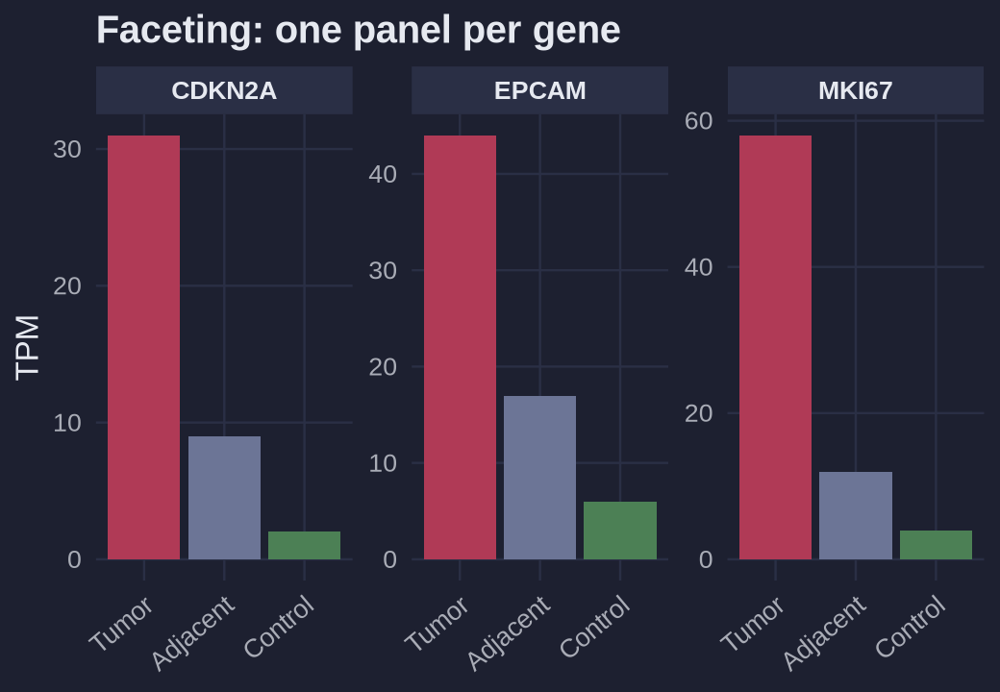{fig-align="center" width="100%"}
:::

::: {.column width="48%"}

- the strip labels say **which gene** each panel is
- `scales = "free_y"` gives each panel its own y-axis: CDKN2A tops at **31**,
  MKI67 at **58**
- 3 genes × 3 samples = **9 bars** in one call

:::

:::::

---

### ⚡ Q3: `ggplot(df, aes(x = sample, y = umi)) + geom_boxplot()` — what do you see?

### ✅ A3: One box per sample

x = sample (categories), y = umi (values), geom_boxplot = boxes. Centre,
spread, and the outliers, for every sample on one page.

---

### ⚡ Q4: `ggplot(heat, aes(x = sample, y = gene, fill = value)) + geom_tile()` — what do you see?

### ✅ A4: A grid of coloured cells — gene × sample

`geom_tile()` draws one rectangle per row of the data. 5 genes × 3 samples =
**15 cells**. `fill` is the value, so the picture is the matrix.

---

## 9. Reading a ggplot2 Call

::: {.agenda data-section="9"}
:::

---

### 🧱 Six layers, read top to bottom

```{webr-r}
ggplot(long, aes(x = sample, y = tpm, fill = sample))  # data + mapping
  + geom_col()                            # what is drawn
  + facet_wrap(~ gene, scales = "free_y")  # panels
  + scale_fill_manual(values = cols)      # colour range
  + coord_cartesian(ylim = c(0, 60))      # axis limits
  + labs(title = "TPM", x = NULL)          # labels
  + theme_minimal()                        # styling
```

Each line adds one thing. Reading a figure's code is reading these lines,
in order, and naming what each one contributes.

---

### 🔀 Long data: the shape ggplot2 needs

::::: {.columns}

::: {.column width="45%"}

**Wide** — 3 rows, 3 gene columns

| sample | MKI67 | CDKN2A | EPCAM |
|---|---|---|---|
| Tumor | 58 | 31 | 44 |
| Adjacent | 12 | 9 | 17 |
| Control | 4 | 2 | 6 |

:::

::: {.column width="55%"}

**Long** — 9 rows, 3 columns

| gene | sample | tpm |
|---|---|---|
| MKI67 | Tumor | 58 |
| MKI67 | Adjacent | 12 |
| MKI67 | Control | 4 |
| CDKN2A | Tumor | 31 |
| ... | ... | ... |

:::

:::::

```{webr-r}
tidyr::pivot_longer(wide, cols = -sample,
                    names_to = "gene", values_to = "tpm")
# reads: 3 gene columns become one gene column and one value column, 9 rows
```

`aes()` maps **columns**. One column of gene names is what `facet_wrap`
splits on, and one column of values is what every gene shares.

---

### 📐 Two scales you will read constantly

- `scale_y_log10()` — each decade gets the same space, so values from 1 to
  1000 stay readable. UMI spans exactly that
- `coord_equal()` — 1 unit of x is the same length as 1 unit of y. A round
  tissue stays round; without it the same spot map becomes an ellipse

::: {.callout-note}
Both change **how you read the picture**, not what is drawn. The dots of the
spot map are identical; the axis is honest.
:::

---

### ⚡ Q5: `ggplot(df, aes(x = gene, y = sample, fill = value)) + geom_tile() + scale_fill_distiller(palette = "YlOrRd")` — what does the `scale` line add?

### ✅ A5: The colour ramp, nothing else

What is drawn is fixed by `geom_tile()`. `scale_fill_distiller()` picks the
yellow-to-red ramp, and the range it maps the values onto. Remove it and you
get the same grid in ggplot2's default colours.

---

### ⚡ Q6: What does `scales = "free_y"` say, reading it?

### ✅ A6: "one panel per gene, each panel its own y-axis"

`facet_wrap(~ gene)` → split by the gene column. `scales = "free_y"` → the
y-axes are independent. Panel CDKN2A runs to 31, panel MKI67 to 58, so the
small values in CDKN2A stay visible.

---

## 10. Spatial &amp; DE Plots

::: {.agenda data-section="10"}
:::

---

### 🗺️ Spatial data keeps x and y

::::: {.columns}

::: {.column width="48%"}
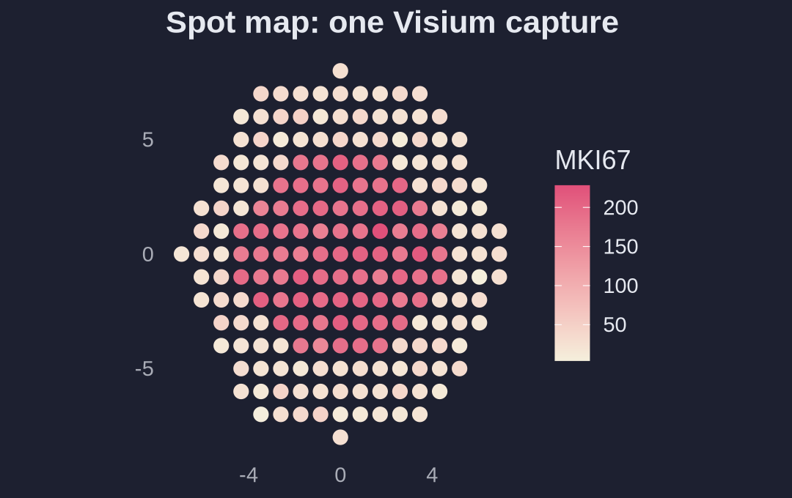{fig-align="center" width="100%"}
:::

::: {.column width="52%"}
```{webr-r}
ggplot(spots, aes(x = x, y = y)) +
  geom_point(aes(colour = expr), size = 2.8) +
  coord_equal() +
  scale_colour_gradient(low = "white", high = "red")
```

- **199** spots, 1 dot each
- **75** spots in the tumor core: mean expression **189.1**
- **124** outside: mean **25.2**
- overall mean **87**, median **35**, max **228**
:::

:::::

---

### 🎻 The violin: the whole distribution, per group

::::: {.columns}

::: {.column width="42%"}
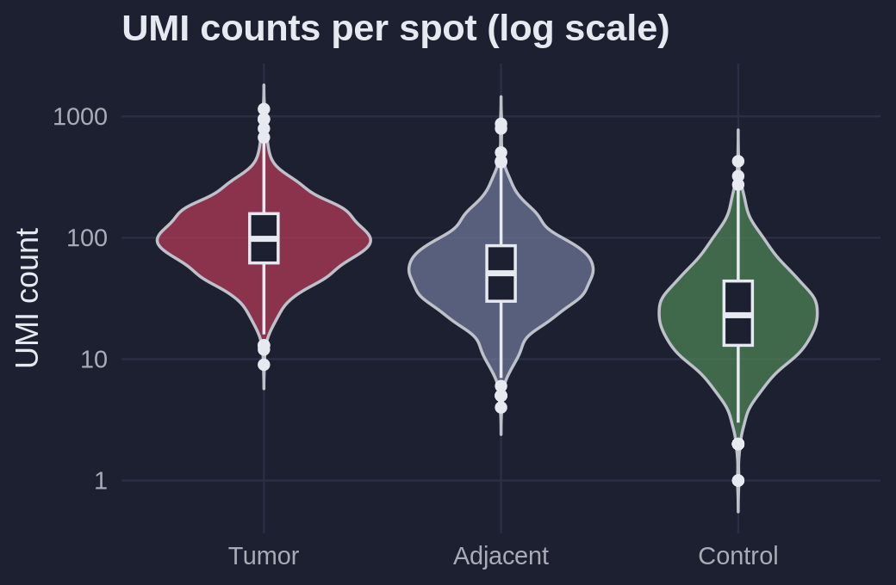{fig-align="center" width="100%"}
:::

::: {.column width="58%"}
```{webr-r}
ggplot(umi, aes(x = sample, y = umi, fill = sample)) +
  geom_violin(trim = FALSE) +
  geom_boxplot(width = 0.12) +
  scale_y_log10()
```

- **1200** spots per sample, **3600** in total
- median UMI: **98** / **51** / **23** (Tumor / Adjacent / Control)
- spots under 50 UMI: **204** / **581** / **950**

:::

:::::

---

### 🌋 The volcano: effect size against significance

::::: {.columns}

::: {.column width="46%"}
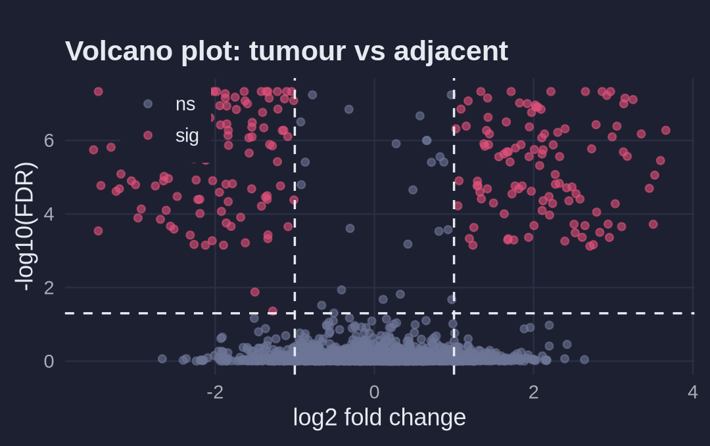{fig-align="center" width="100%"}
:::

::: {.column width="54%"}
```{webr-r}
ggplot(de, aes(x = log2FC, y = -log10(padj),
              colour = state)) +
  geom_point() +
  geom_hline(yintercept = -log10(0.05),
             linetype = "dashed") +
  geom_vline(xintercept = c(-1, 1),
             linetype = "dashed")
```

- **2000** genes: **321** pass raw p &lt; 0.05
- **248** pass BH FDR &lt; 0.05 — **73** of them were noise
- **224** pass FDR &lt; 0.05 **and** |log2FC| &gt; 1: **109 up**, **115 down**
:::

:::::

---

### 🟥 The heatmap: log(count + 1)

::::: {.columns}

::: {.column width="40%"}
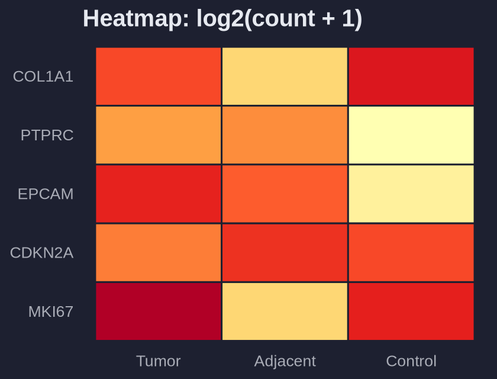{fig-align="center" width="100%"}
:::

::: {.column width="60%"}
```{webr-r}
heat$value <- log2(counts + 1)
ggplot(heat, aes(x = sample, y = gene,
                 fill = value)) +
  geom_tile() +
  scale_fill_distiller(palette = "YlOrRd")
```

- **15 cells**: 5 genes × 3 samples
- raw counts run **4** to **1120**, 280× apart: one gene would own the colour
  scale
- `log2(count + 1)` runs **2.32** to **10.13**
- the **+1** is for zeros: `log2(0)` is `-Inf`, and a real spatial matrix is
  mostly zero
:::

:::::

---

### ⚡ Q7: In the volcano, what is one dot, and what are the dashed lines?

### ✅ A7: One dot = one gene; the dashes are the thresholds

Vertical dashes: |log2FC| = 1. Horizontal dash: FDR = 0.05, because
`-log10(0.05)` is 1.30. The interesting genes sit in the top corners: big
effect **and** small FDR.

---

### ⚡ Q8: In the heatmap, what is one cell?

### ✅ A8: One gene in one sample

The cell's colour is `log2(count + 1)` for that pair. A dark cell is a high
count, a pale cell is a low count. The colour scale is the only thing turning
numbers into colour, so read the scale bar with the matrix.

---

## 11. Export for Publication

::: {.agenda data-section="11"}
:::

---

### 💾 ggsave writes the file

```{webr-r}
ggsave("volcano.pdf",     p_vol, width = 5.4, height = 3.4)
ggsave("volcano_300.png", p_vol, width = 5.4, height = 3.4, dpi = 300)
ggsave("volcano_72.png",  p_vol, width = 5.4, height = 3.4, dpi = 72)
```

Same picture, three files:

| file | bytes |
|---|---|
| `volcano.pdf` | **119,518** |
| `volcano_300.png` | **258,672** |
| `volcano_72.png` | **39,038** |

- 300 dpi is **6.6×** the 72 dpi file
- the PDF is **2.2× smaller** than the 300 dpi PNG
- **PNG** is pixels: 5.4 × 3.4 in is 389 × 245 px at 72 dpi, 1620 × 1020 px at
  300 dpi. **PDF** stores commands, so it scales to any print size

---

### ✅ Before a figure leaves your laptop

- the figure is sized for **print** (5.4 in), not for the screen
- every axis label carries **units**; every panel has a letter (A, B, C)
- the legend states the test and the threshold: "FDR &lt; 0.05,
  |log2FC| &gt; 1"
- the palette is colourblind-safe, not red/green only
- the **code and the data table** behind each figure are saved together
- journals ask 300 dpi for photos, heatmaps, and spots; vector for line art

::: {.callout-important}
A figure is a claim. If you cannot rebuild it from the code, you cannot
defend it.
:::

---

### ⚡ Q9: What changes between `dpi = 72` and `dpi = 300`?

### ✅ A9: Pixels per inch, and the file size

The figure content is identical. Pixels grow **17.4×** (the square of the dpi
ratio), bytes grow **6.6×** because flat areas compress well. A 72 dpi figure
printed at journal size is blurry; 300 dpi is the usual ask.

---

## 12. Graphics Practice

::: {.agenda data-section="12"}
:::

---

### ✍️ Exercise 1: Read the code

This is the code for the spot map:

```{webr-r}
p <- ggplot(spots, aes(x = x, y = y)) +
  geom_point(aes(colour = expr), size = 2.8) +
  coord_equal() +
  scale_colour_gradient(low = "#f5efdc", high = "#e0507a", name = "MKI67") +
  labs(title = "Spot map", x = NULL, y = NULL) +
  theme_minimal()
ggsave("spot_map.png", p, width = 5.4, height = 3.4, dpi = 300)
```

1. what data, and what is drawn?
2. what becomes colour?
3. what does `coord_equal()` do?
4. what does `ggsave()` add?

::: {.slide-kicker}
Your Turn!
:::

---

### ✅ Exercise 1: Answers

1. **data**: `spots`, 199 rows. **geometry**: dots (`geom_point`), size 2.8
2. **colour**: the `expr` column, from pale `#f5efdc` to `#e0507a`. The
   `scale_colour_gradient()` line only sets that ramp
3. **`coord_equal()`**: keeps 1 unit of x equal to 1 unit of y, so the tissue
   keeps its shape
4. **`ggsave()`**: writes the file at 5.4 × 3.4 in, 300 dpi, and closes the
   device

The numbers behind the picture: **199** spots, **75** in the core (mean
**189.1**), **124** outside (mean **25.2**). The figure is 109,988 bytes at
200 dpi.

---

### ✍️ Exercise 2: Read the caption, not the picture

A paper says:

> Volcano plot, tumor vs adjacent. **248** genes pass BH-adjusted FDR
> &lt; 0.05; **224** also pass |log2FC| &gt; 1 (**109** up, **115** down).
> Dashed lines mark FDR = 0.05 and |log2FC| = 1.

1. how many genes were tested?
2. what did FDR remove?
3. where do the "interesting" genes sit on the figure?
4. export this figure for print, in the format that scales.

::: {.slide-kicker}
Your Turn!
:::

---

### ✅ Exercise 2: Answers

1. **2000** genes were tested, so 100 of them pass raw p &lt; 0.05 by chance
2. BH kept **248**; **73** of the raw winners were noise
3. in the **top corners**: |log2FC| &gt; 1 **and** low FDR — **109** up
   (log2FC &gt; 1), **115** down (log2FC &lt; -1)
4. `ggsave("volcano.pdf", p_vol, width = 5.4, height = 3.4)` — vector,
   **119,518 bytes**

The counts in the caption are the claim. The figure is the evidence.

---

## 🧠 Recap

- **descriptive**: mean, median, sd, IQR — report centre and spread;
  **mean and median together** tell you the shape
- **Shapiro-Wilk**: p &gt; 0.05 = normal, p ≤ 0.05 = use ranks
- **the test is a decision, not a default**: t / Wilcoxon / ANOVA / KW /
  Fisher / χ²
- **p** = how surprising the data is, assuming no effect
- **20,000 genes** → Bonferroni or BH, every time
- **correlation ≠ causation**, spatial data is not independent
- **name the test** in the figure legend
- **read a plot call with 3 questions**: data, geometry, mapping
- **8 plots cover most papers**; verb prefixes name the job: `geom_*` draws,
  `scale_*` ranges, `coord_*` shape, `facet_*` panels, `labs`/`theme` labels
- **a device is a file**: `png()` needs `dev.off()`, `ggsave()` closes for you;
  export for print: 5.4 in, 300 dpi raster, PDF for line art

---

## 🚀 What's Next?

**Module III — Single-cell RNA-seq**

- the same statistics on **10,000+ cells** instead of 3 samples: QC
  thresholds, distributions, batch effects
- the same plots on bigger objects: UMI distributions, gene-by-cell maps,
  cluster marker figures
- spatial spots keep their x, y — the figure is the readout

The full pipeline, end to end: counts → QC → statistics → figure.

---

### 📚 Sources & Licenses

- R Core Team, **R 4.5.3** — base stats: `mean`, `median`, `sd`, `quantile`,
  `summary`, `t.test`, `wilcox.test`, `kruskal.test`, `aov`, `chisq.test`,
  `fisher.test`, `shapiro.test`, `cor.test`, `lm`, `p.adjust`, `qqnorm`, `qqline`
- Shapiro & Wilk (1965) *Biometrika* 52:591-611 · Benjamini & Hochberg (1995)
  *JRSS-B* 57:285-307
- Wickham, H. **ggplot2 4.0.3** — `ggplot`, `aes`, `geom_*`, `scale_*`,
  `facet_wrap`, `coord_equal`, `ggsave`; with **dplyr**, **tidyr**
  (`pivot_longer`), **ggridges**, **RColorBrewer**
- **every figure and number in this deck** is drawn in the course's
  `R_tutorial` env (R 4.5.3, ggplot2 4.0.3, ggridges 0.5.7) on `png()` /
  `pdf()` devices, fixed seed
- Course data: **GSE129221** — Song et al. (2019) Cancer Cell Int 19:117
- **p-value meme** (section 4) — FB: `@Statisticss` · IG: `@StatisticsForYou`; image
  via Google Images: [encrypted-tbn0.gstatic.com](https://encrypted-tbn0.gstatic.com/images?q=tbn:ANd9GcRXpp3pINnzFSvCjsztyHpUuEUrASfQBQ7KrqcRq2yvQBfF1ofyayYX-v_O&s=10)
- **Gulls on a bent railing** (section 5, "Correlation is not causation") — photo via
  X: [pbs.twimg.com/media/FAW2hMeWEAAfcvm](https://pbs.twimg.com/media/FAW2hMeWEAAfcvm?format=webp&name=large)
- Deck: Quarto 1.10.19 · revealjs · `slides.css`

---

## Thank You! {.center style="text-align: center; margin-top: 1.2em;"}

::: {.quote}
The job is not to make the numbers big.
It is to make the claim defensible.
:::
