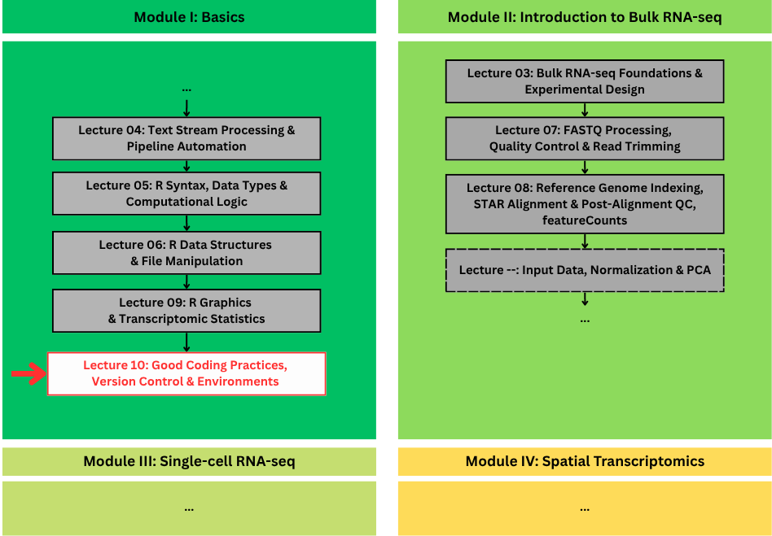
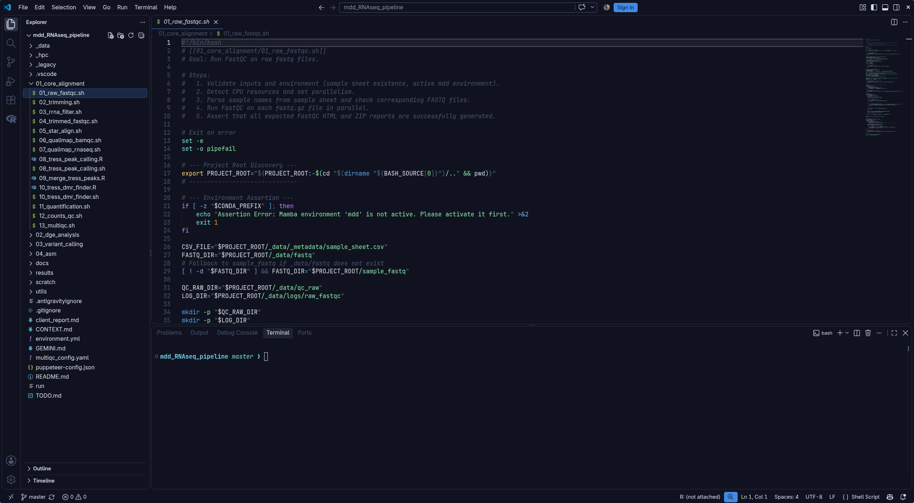
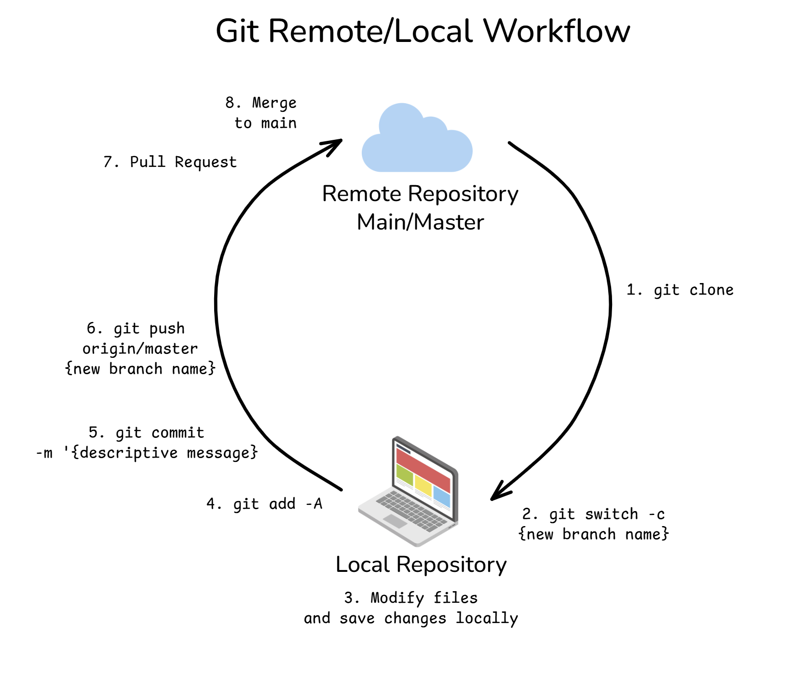
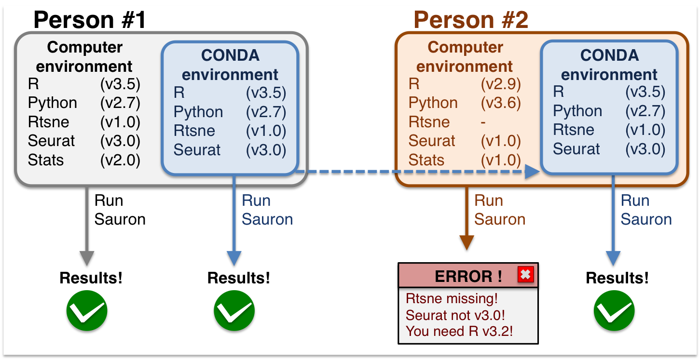

## 🗺️ From Spaghetti Code to Reproducible Work

{fig-align="center" width="60%"}

---

## 🗺️ Where Lecture 10 sits

- **Lectures 1, 2, 4**: Linux, text streams, pipelines
- **Lectures 5, 6, 9**: R, counts, statistics and graphics
- **Lecture 10** makes the work reproducible: version control, project layout, environments, and clean code.

---

## 🧠 Quick recap

- The unit is the **sample**: control vs apatinib, 3 vs 3
- Test the **shape first**: Shapiro-Wilk, then t-test or Wilcoxon
- Correct for **20,000 tests**: Bonferroni or BH
- **A figure is a claim**: data, geometry, mapping — read it in that order

---

## 1. Editors: Writing Scripts in VS Code

::: {.agenda data-section="1"}
:::

---

### 🖥️ The problem: terminal one-liners don't last

- So far you've run one command at a time in the terminal.
- Now you want to save work as **scripts**: `01_prepare.R`, `clean.sh`, ...
- Which editor keeps `*.R` and `*.sh` in one place, with syntax help and run buttons?

---

### 🖥️ VS Code — one editor for R and bash

- **IDE**: a code editor with run buttons, terminals, and extensions.
- **VS Code** by Microsoft (2015), free and open — <https://code.visualstudio.com> — one place for `*.R`, `*.sh`, `*.md`.

{fig-align="center" width="20%"}

---

### 📥 Install VS Code (Ubuntu, default)

- Download the `.deb` from <https://code.visualstudio.com/Download> once, then:

```bash
sudo apt update
sudo apt install ./code_*.deb
code   # open
```

- Open VS Code, install the **R** extension (`bradford.r`) for `*.R`.

---

### 🖥️ VS Code interface: `mdd_RNAseq_pipeline`

:::: {.columns}

::: {.column width="75%"}

{fig-align="center" width="100%"}

:::

::: {.column width="25%"}

::: {.small}
- **Explorer** — project files on the left (`01_core_alignment/`, `_data/`, `results/`).
- **Code editor** — the open script in the middle (`01_raw_fastqc.sh`).
- **Terminal** — run it at the bottom (`mdd_RNAseq_pipeline master` prompt).
:::

:::

::::

---

### 🔀 RStudio vs VS Code — why VS Code here?

:::: {.columns}


::: {.column width="50%"}


:::

::: {.column width="50%"}

- **RStudio**: classic R-only IDE. One language, opinionated.
- **VS Code**: versatile — `*.R`, `*.sh`, `*.py`, `*.md` in one window, with terminals and Jupyter notebooks.

:::
- We use **VS Code** for the whole pipeline, not R alone.

::::

---

### 🖥️ Example 1: a bash script in VS Code

:::: {.columns}

::: {.column width="60%"}

```bash
#!/bin/bash
# goal: run FastQC on the Lecture 8 reads
set -e

tar -xzf lecture-08-data.tar.gz
mkdir -p data/qc_raw
fastqc data/raw_fastq/*.fq -o data/qc_raw
```

:::

::: {.column width="40%"}

- One file, one job: `01_raw_fastqc.sh`.
- Open it in the **Editor**; run it in the **Terminal**: `bash 01_raw_fastqc.sh`.

:::

::::

---

### 🖥️ Example 2: an R script in VS Code

:::: {.columns}

::: {.column width="60%"}

```r
# goal: mean TPM per gene, then a bar
counts <- read.table("data/counts/counts.tsv", sep = "\t", header = TRUE)
mat <- as.matrix(counts[-1])
tpm <- mat / rep(colSums(mat), each = nrow(mat)) * 1e6
mean_tpm <- data.frame(gene = counts$GeneID, tpm = rowMeans(tpm))
top <- head(mean_tpm[order(-mean_tpm$tpm), ], 20)
write.csv(top, "results/mean_tpm.csv", row.names = FALSE)

library(ggplot2)
ggsave("results/mean_tpm.png",
  ggplot(top, aes(x = reorder(factor(gene), tpm), y = tpm)) +
    geom_col() + coord_flip() + theme_minimal(),
  width = 5.4, height = 3.4)
```

:::

::: {.column width="40%"}

- One file, one step: `02_analyse.R`, numbered in run order.
- Reads `data/counts/counts.tsv`, writes `results/` — never edits the raw reads.
- Run with the R run button or the Terminal.

:::

::::

---

## 2. Good Coding Practices

::: {.agenda data-section="2"}
:::

---

### 🍝 Spaghetti code: `x`, `temp`, `data2`

```r
d <- data.frame(val = c(12, 18, 5, 22))
v1 <- d$val[1] * 2
res <- c(v1, d$val[2] * 2)
```

- Six months later, no one reads it; a colleague cannot replicate you.

---

### 📏 Naming: nouns for data, verbs for actions

- **Variables** (snake_case): `raw_counts`, `filtered_spots`
- **Functions** (verbs): `calculate_average()`, `filter_failed_samples()`

:::: {.columns}

::: {.column width="50%"}

**Bad**

```r
x
my_func
# final version
```

:::

::: {.column width="50%"}

**Good**

```r
raw_counts
calculate_average()
# 03_plot_results.R
```

:::

::::

---

### ✅ Solution: naming

```r
raw_counts <- c(12, 18, 5, 22)
filtered_spots <- raw_counts[raw_counts > 10]
```

- Nouns say what is stored; one style, everywhere.

---

### 🧩 Functions: write once, reuse everywhere

```r
(32 - 32) * 5 / 9    # 0
(212 - 32) * 5 / 9   # 100
```

- **Bad**: the same formula copy-pasted twice. One typo and the two copies diverge.

---

### ✅ Solution: a function for the temp conversion

```r
fahrenheit_to_celsius <- function(temp_f) {
  (temp_f - 32) * 5 / 9
}
fahrenheit_to_celsius(c(32, 212))  # 20? -> 0, 100 for single runs
```

- One formula, many calls. DRY.

---

### 💬 Comments: say something the name doesn't

```r
# Average cell counts in one column.
calculate_average_cells <- function(dataset, column_name) {
  values <- dataset[, column_name]
  mean(values, na.rm = TRUE)
}
```

- **Bad**: the comment just repeats the function name — it adds nothing.

---

### ✅ Solution: comments that work

```r
# Input: dataset | column_name. Output: one number (NA-safe mean).
calculate_average_cells <- function(dataset, column_name) {
  values <- dataset[, column_name]
  mean(values, na.rm = TRUE)
}
```

- What, inputs, output — in that order.

---

### 🛡️ Defensive: check before you compute

```r
calculate_percentage <- function(count, total) {
  (count / total) * 100
}
```

- **Bad**: no check — a zero `total` gives `Inf` with no message.

---

### ✅ Solution: `stop()` before divide

```r
calculate_percentage <- function(count, total) {
  if (total == 0) {
    stop("Total cannot be zero!")
  }
  (count / total) * 100
}
calculate_percentage(5, 20)  # 25
# calculate_percentage(5, 0) # stop
```

---

### 🧹 Refactor in one pass

```r
double_values <- function(numbers) {
  if (!is.numeric(numbers)) {
    stop("Input must be a numeric vector.")
  }
  numbers * 2
}

expression_data <- data.frame(counts = c(12, 18, 5, 22))
double_values(expression_data$counts)  # 24 36 10 44
```

- The messy `v1, v2, v3…` loop becomes one named function.

---

### 🗂️ The problem: raw data overwritten

- 15 script versions + 10 CSVs + dozens of plots in one folder.
- One wrong edit and the original sequencing file is gone.

---

### 🗂️ Numbered steps, read-only inputs, generated outputs

```text
project/
├── analysis.R
├── analysis_final.R
├── analysis_final_v2.R
├── analysis_really_final.R
├── results_final.csv
├── results_v3.png
└── ...
```

- **Bad**: everything floats in one folder, `final` in every name. Which one is real?

---

### ✅ Solution: numbered layout

```text
demo/
├── 01_raw_fastqc.sh    # run first
├── 02_analyse.R        # run second
├── data/
│   ├── raw_fastq/           # unpacked, never edit
│   ├── counts/counts.tsv    # the real input
│   └── qc_raw/              # generated, not committed
├── results/
│   ├── mean_tpm.csv         # generated
│   └── mean_tpm.png         # generated
├── environment.yml          # the toolbox recipe
├── README.md                # how to run it
└── .gitignore               # what Git must skip
```

- Numbers = run order. Inputs stay read-only, outputs are rebuilt.
- `README.md` + `environment.yml` + `.gitignore` tell a colleague how to rebuild it.

---

### 📍 Paths that work everywhere: `here`

- The problem: your absolute path breaks on a colleague's machine.

```r
library(here)
file_path <- here("data", "raw", "metadata.csv")
my_data <- read.csv(file_path)
```

- `here()` finds the project root; pass subfolders as parts.

---

### ✅ Solution: `here()` paths

```r
library(here)
csv_path <- here("data", "raw", "metadata.csv")
my_data <- read.csv(csv_path)
```

- Same code works on anyone's machine — the root is found, not typed.

---

## 3. Version Control with Git

::: {.agenda data-section="3"}
:::

---

### 🗑️ The problem: no checkpoints, no log

- Day 1: you add the filter code and it works.
- Day 2: you fix a bug — and accidentally delete a helper function. It breaks, and you cannot recover it.
- A reviewer asks: "What changed, and when?" You have no dev log to answer.

---

### 🕑 Git is a time machine

- Each **commit** is a checkpoint.
- **Git** tracks *what changed*; **GitHub** shares it.

{fig-align="center" width="12%"}
{fig-align="center" width="30%"}

- **Git** by Linus Torvalds (2005) — <https://git-scm.com>  
- **GitHub** — <https://github.com> 

---

### 📥 Install Git (Ubuntu, default)

```bash
sudo apt update
sudo apt install git
git --version
git config --global user.name "Your Name"
git config --global user.email "you@example.com"
```

- One-time identity setup. Then `git init` in your project.

---

### 📦 Three places Git keeps your work

:::: {.columns}

::: {.column width="50%"}

```bash
git status
```

- **Working directory** — where you edit.
- **Staging area** — the loading dock: choose what to save.
- **Local repository** — the checkpoints (commits).

:::

::: {.column width="50%"}

{fig-align="center" width="100%"}

:::

::::

---

### 🚀 The four commands that cover 90%

```bash
git init                       # start tracking
git status                     # what changed
git add script.R               # stage
git commit -m "Add stuff"      # save
```

---

### 🌐 GitHub: push and pull

- **Push** — send your commits up. **Pull** — download others.

```bash
git remote add origin https://github.com/yourname/my_project.git
git push -u origin main
git pull origin main
```

::: {.callout-warning}
No passwords on GitHub: use a token (PAT) or an SSH key.
:::

---

### 🌿 Branch 1: create — a new copy of the work

```bash
git branch feat_umap
```

- Make a **branch**: a new pointer, same commits. `main` stays stable.

---

### 🌿 Branch 2: switch — work on the copy

```bash
git checkout feat_umap
```

- `HEAD` moves to the branch. Edits and commits land there.

---

### 🌿 Branch 3: merge — bring it back after testing

```bash
git checkout main
git merge feat_umap
```

- Switch back, then merge the branch commits into `main`.

---

### 🌿 Branch 4: cherry-pick — one commit, not the whole branch

```bash
git cherry-pick <commit-hash>
```

- Copy a single commit from another branch into the current one.

---

### ⚠️ Merge conflicts: pick one line, delete the markers

```txt
<<<<<<< HEAD
tpm <- log2(counts + 0.1)
=======
tpm <- log10(counts + 1)
>>>>>>> feat_umap
```

- Keep the correct line, remove `<<<<<<<`, `=======`, `>>>>>>>`, then `git add` + `git commit`.

---

### 🚫 `.gitignore`: never track data

```gitignore
# generated — rebuild, never commit
data/qc_raw/
results/

# unpacked from the archive, not stored in git
data/raw_fastq/
lecture-08-data.tar.gz

# experiments that are not part of the pipeline
scratch/
```

- Git tracks the two scripts, `README.md`, `environment.yml`. The QC reports, plots, and the 56 MB archive stay local.

---

## 4. Environments: Colab, Micromamba

::: {.agenda data-section="4"}
:::

---

### 😵 Dependency hell

- Seurat 4.0 installed, 5.0 required — updating one script breaks another.
- **Environments** = separate toolboxes per project. A recipe file rebuilds the exact toolbox.

{fig-align="center" width="85%"}

---

### ☁️ Colab: R instantly in the browser (you know this one)

- No install, free cloud CPU/RAM — what you've used for Lectures 5, 6, 9.
- Notebook = **code cells** (▶ or `Ctrl + Enter`) + **Markdown cells** (notes).
- **Runtime → Change runtime → R**, `+ Code`, ▶, upload in **Files** → `read.csv("/content/metadata.csv")`

::: {.callout-warning}
Uploads vanish on idle. Mount **Google Drive** to keep files.
:::

---

### 🐍 What is conda?

:::: {.columns}

::: {.column width="60%"}

- Package, dependency, and **environment** manager for R and Python.
- An **environment** is one isolated toolbox: R + packages + versions.

:::

::: {.column width="40%"}

{fig-align="center"}

:::

- **Conda** by Anaconda (2015), open source — <https://conda.io>
- **conda-forge** — community channel for open packages.

::::

---


### 📦 Conda vs Micromamba: same recipe, faster builder

- **Conda** — original manager; slow solver, heavy base.
- **Micromamba** — same `environment.yml`, tiny binary, fast solver. Drop-in replacement.
- Both rebuild the identical toolbox from the file on any machine.

---

### 📥 Install Micromamba (Ubuntu, default)

```bash
mkdir -p ~/bin
curl -s https://micro.mamba.pm/api/micromamba/linux-64/latest -o ~/bin/micromamba
chmod +x ~/bin/micromamba
micromamba --version
```

- No `sudo` needed: one static binary into `~/bin`.

::: {.callout-note}
Optional: `echo 'export PATH="$HOME/bin:$PATH"' >> ~/.bashrc` — puts `~/bin` on your `PATH` in every new terminal.
:::

---

### 📦 `environment.yml`: the toolbox recipe

```yaml
name: demo
channels:
  - conda-forge
  - bioconda
dependencies:
  - fastqc=0.12.1
  - r-base=4.4.1
  - r-ggplot2=4.0.3
```

- `channels` = where packages come from; `dependencies` = the exact tools and versions.
- Pinned versions are what the demo runs: FastQC 0.12.1, R 4.4.1, ggplot2 4.0.3.

---

### ⚙️ Step 1: Create — build the toolbox

```fish
micromamba create -f environment.yml
```

- Reads the recipe; creates a new environment named `demo`.

---

### ⚙️ Step 2: Activate — enter the toolbox

```fish
micromamba activate demo
```

::: {.callout-note}
Optional, once: `micromamba run -n demo R -e 'IRkernel::installspec(user = TRUE)'` — registers R for your notebook.
:::

- The only command you need. The callout is a one-time notebook setup.

---

### ⚙️ Step 3: Update — after you edit the recipe

```fish
micromamba env update -n demo -f environment.yml --prune
```

- Adds or removes packages to match the file. 
- `--prune` removes what is no longer listed.

---

### ⚙️ Step 4: List — see what you have

```fish
micromamba env list
```

- One line per environment on this machine.

---

### ⚙️ Step 5: Leave and delete

```fish
micromamba deactivate
micromamba env remove -n demo
```

- Leave when done. Remove deletes the toolbox for good.

Only run `micromamba clean --all` if you are out of disk — it deletes the package cache.

---

## 5. Practice

::: {.agenda data-section="5"}
:::

---

### 📝 Practice quiz — pick A or B

No blanks, no answers here. Just choose.

---

### ⚡ Q1: Which saves a checkpoint?

:::: {.columns}

::: {.column width="55%"}

```fish
git status
git add script.R
```

:::

::: {.column width="45%"}

- **A.** `git status`
- **B.** `git commit`

:::

::::

---

### ✅ **B** — `git commit`

:::: {.columns}

::: {.column width="50%"}

```fish
git commit -m "Add cleaning script"
```

:::

::: {.column width="50%"}

- **A** `git status` only reports what changed.
- **B** `git commit` saves the staged snapshot.

:::

::::

Status reports. Commit saves.

---

### ⚡ Q2: Which folder is never edited?

:::: {.columns}

::: {.column width="55%"}

```text
data/
results/
```

:::

::: {.column width="45%"}

- **A.** `data/`
- **B.** `results/`

:::

::::

---

### ✅ **A** — `data/`

:::: {.columns}

::: {.column width="50%"}

```text
data/     # inputs, never edited
results/  # generated by code
```

:::

::: {.column width="50%"}

- **A** `data/` holds the original inputs.
- **B** `results/` is written by code, so it can change.

:::

::::

Never edit inputs.

---

### ⚡ Q3: What rebuilds the toolbox on any machine?

:::: {.columns}

::: {.column width="55%"}

```yaml
name: demo
dependencies:
  - fastqc=0.12.1
  - r-base=4.4.1
  - r-ggplot2=4.0.3
```

:::

::: {.column width="45%"}

- **A.** `.gitignore`
- **B.** `environment.yml`

:::

::::

---

### ✅ **B** — `environment.yml`

:::: {.columns}

::: {.column width="50%"}

```fish
micromamba create -f environment.yml
```

:::

::: {.column width="50%"}

- **A** `.gitignore` only ignores data files in Git.
- **B** The recipe lists R and every package; one command rebuilds it.

:::

::::

One file rebuilds the toolbox.

---

### ⚡ Q4: Which name is snake_case?

:::: {.columns}

::: {.column width="55%"}

```r
# Which one is snake_case?
```

:::

::: {.column width="45%"}

- **A.** `my_data_table`
- **B.** `myDataTable`

:::

::::

---

### ✅ **A** — `my_data_table`

:::: {.columns}

::: {.column width="50%"}

```r
raw_counts <- c(12, 18, 5, 22)
calculate_average(raw_counts)
```

:::

::: {.column width="50%"}

- **A** snake_case: lowercase words joined by `_`.
- **B** camelCase: capitals mark each word.

:::

::::

Pick one style and stay with it.

---

### ⚡ Q5: What does `stop()` do?

:::: {.columns}

::: {.column width="55%"}

```r
if (total == 0) {
  stop("Total cannot be zero!")
}
```

:::

::: {.column width="45%"}

- **A.** prints a message
- **B.** halts with an error

:::

::::

---

### ✅ **B** — halts with an error

:::: {.columns}

::: {.column width="50%"}

```r
calculate_percentage(5, 0)
# Error: Total cannot be zero!
```

:::

::: {.column width="50%"}

- **A** `print()` shows a message and continues; `stop()` ends it.
- **B** Check before you compute, then stop if the input is invalid.

:::

::::

Check inputs before you compute.

---

## 🧠 Recap

- **Good code (with project)**: snake_case, verbs for functions, DRY, numbered steps with read-only `_data`, `here()` paths, `stop()` before you compute.
- **Git**: working → staging → commit; branches protect `main`. Never track data — `.gitignore`.
- **Environments**: Colab for instant R; `environment.yml` + Micromamba locally (R and Python).

---

## 🚀 What's Next?

**Module III — Single-cell RNA-seq**

- the same reproducible habits, on **10,000+ cells**: QC, batch, clusters
- the same project layout, bigger data.

Counts → QC → statistics → figure — with Git and environments behind it.

---

### 📚 Sources

- Git — <https://git-scm.com>
- GitHub — <https://github.com>
- Conda — <https://conda.io>
- Micromamba — <https://mamba.readthedocs.io/>
- Colab — <https://colab.to/r>
- tidyverse style — <https://style.tidyverse.org/>

---

## Thank You! {.center style="text-align: center; margin-top: 1.2em;"}

::: {.quote}
Keep the code boring.
So the science can be interesting.
:::